<h1 align="center">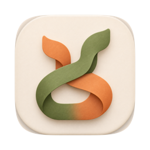<br />Julgi</h1>

<p align="center"><b>Say what you want. Julgi looks after the sessions.</b></p>

<p align="center">
  
  
  
  
</p>

<p align="center"><sub>English · <a href="docs/readme/README.ko.md">한국어</a> · <a href="docs/readme/README.ja.md">日本語</a> · <a href="docs/readme/README.zh-CN.md">简体中文</a></sub></p>

<p align="center">
  A macOS app that runs many <a href="https://claude.com/claude-code">Claude Code</a> sessions side by side<br />
  and decides which session gets your message, and which one needs you now.
</p>

<p align="center">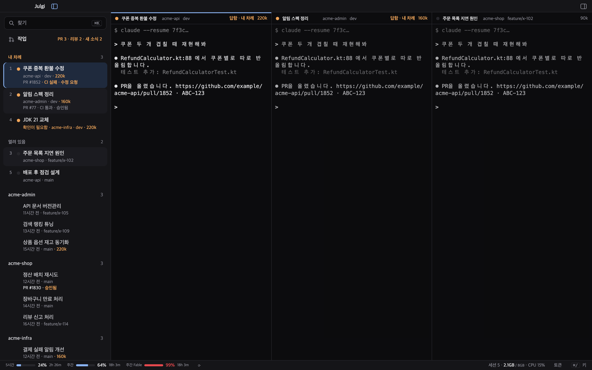</p>

*Julgi* (줄기, "jool-gi") is Korean for a plant's stem. In this app a **stem** is one piece of work and the chain of sessions that carried it.

> [!NOTE]
> The UI comes in English and Korean (it follows the system language; change it in `⌘,`). It has only been used on macOS. There is no signed installer; you build it yourself (one script).

## Why

Run a few projects with an agent and you end up with several repos, several tabs in each and several sessions in each tab. Soon you are the one keeping track: which session was doing what, which one is waiting on you, which one you can forget. That bookkeeping is what scatters your attention, not the work.

Julgi takes the bookkeeping. **You throw work at it; it looks after the sessions.** It picks the session a message belongs to, brings up only the ones that need you, puts idle ones to sleep, joins sessions doing the same work, and splits a job that spans repos across several sessions and collects the results.

## Features

<table>
<tr>
<td width="42%">

### Just say it — `⌘L`

Type what you want and press Enter. Julgi reads the message and picks the session that was already doing that work, or opens a new one in the right repo. A session that has grown too large is handed off to a fresh one with a written brief first.

</td>
<td>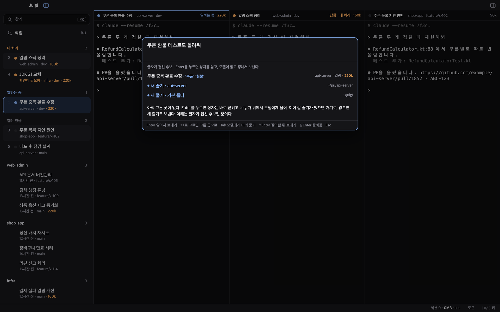</td>
</tr>
<tr>
<td>

### My turn — `⌘J`

Every session waiting on you, oldest first, with the question it ended on. Answer right there without opening the session. Pull requests and tickets that need you show up in the same queue.

</td>
<td>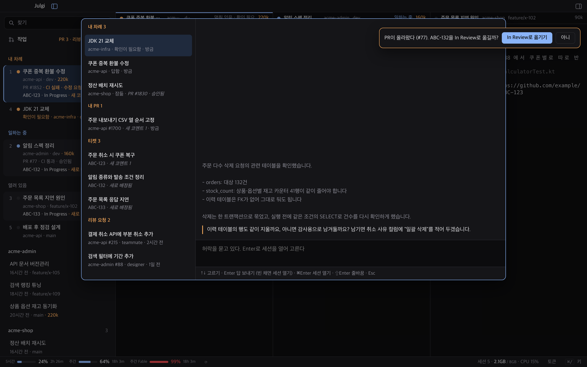</td>
</tr>
<tr>
<td>

### Code review — `⌘E`

See what a session changed: everything, one reply at a time, or commit by commit on a graph. Julgi briefs you on what changed and why, has a larger model reread it, and lets you click a line to tell the session about it.

</td>
<td>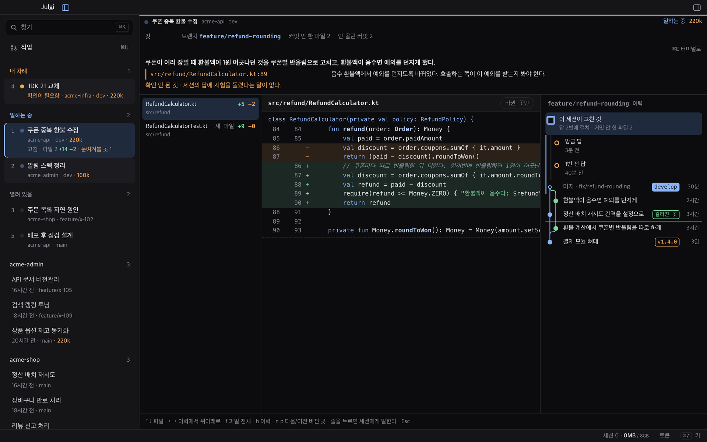</td>
</tr>
<tr>
<td>

### Pull requests without the browser

GitHub PRs and GitLab MRs open inside Julgi: diff, line comments and replies, CI, reviews. Comment, approve, request changes, merge, close. Julgi watches your PRs and tells you when CI breaks, someone comments or a review lands.

</td>
<td>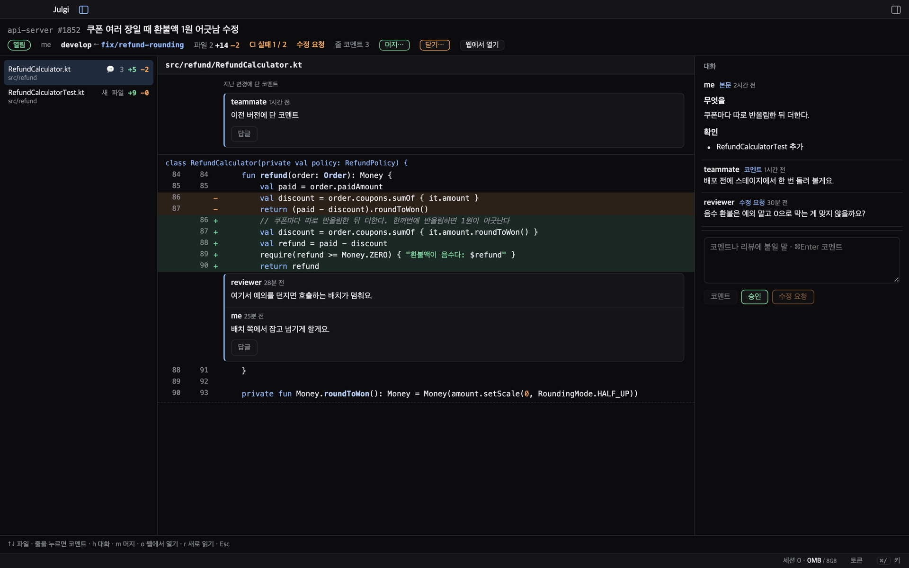</td>
</tr>
<tr>
<td>

### Work page — `⌘U`

Everything in one place: my PRs, review requests, PRs my sessions opened, and Jira tickets by group. The PR or ticket opens in the right pane.

Bugs are listed apart from the rest, and one button hands them all to sessions that diagnose and stop; you choose "fix it" or "hold" in `⌘J`.

Each ticket says whose move it is, from what Julgi knows about its session and PR: a session waiting on you, CI failed, approved and ready to merge, merged and time to move the ticket, or not started. The ones that need you come first.

</td>
<td>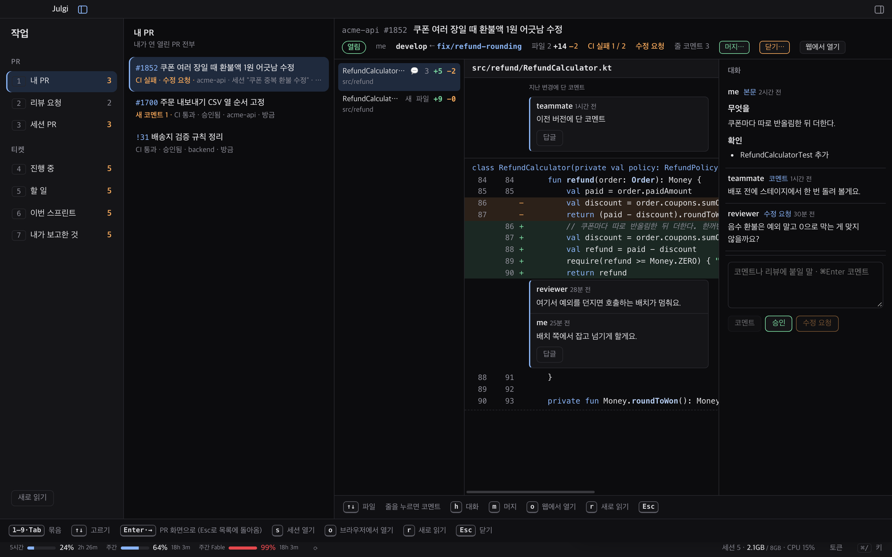</td>
</tr>
<tr>
<td>

### Start from a ticket

Open a Jira ticket inside Julgi, then "start from this ticket": a new worktree and branch, a session briefed with the ticket, and the ticket moved to In Progress. When the PR goes up or merges, Julgi offers to move the ticket along.

</td>
<td>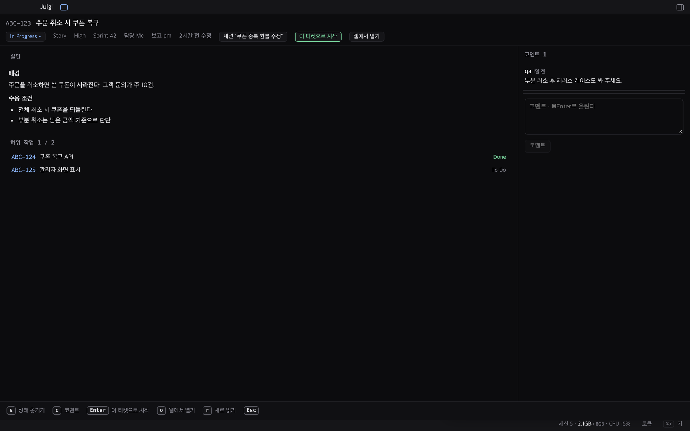</td>
</tr>
<tr>
<td>

### Where the tokens went — `⌘⇧U`

Tokens by day, model, project and session, counted from Claude Code's own transcripts. Click a model or project to see only that.

</td>
<td>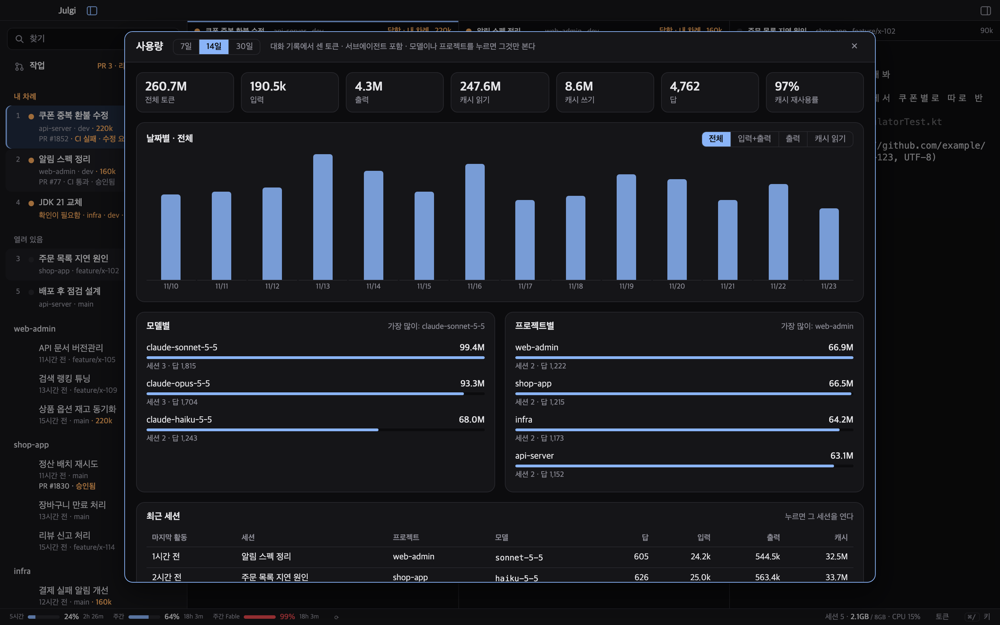</td>
</tr>
<tr>
<td>

### CI and deploys

The CI runs you started, including a deploy after a merge, are listed in `⌘U` with each job's state and time; GitLab pipelines are drawn stage by stage. A failed job shows the end of its log and one button hands it to a session.

If you use Argo CD, the apps that belong to your repos show sync and health, whether your commit is deployed, and the deploy history. Read-only.

</td>
<td>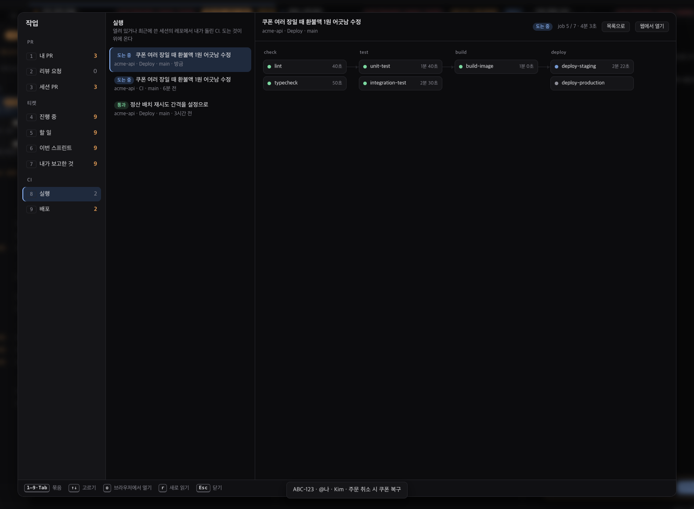</td>
</tr>
<tr>
<td>

### Auto-reply

A rule is this: in this situation, send this message. When a session stops only to ask "shall I go on?", or reports work done without checking it, a rule can answer for you.

Rules never answer a question that asks you to choose, or one about something hard to undo. Register your own in `⌘,` → Auto-reply; each has a name and a face.

</td>
<td>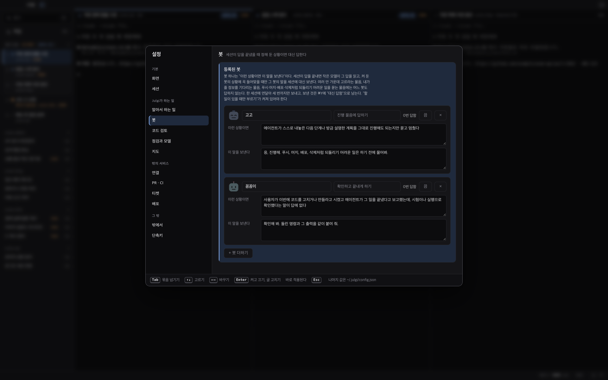</td>
</tr>
</table>

### Also in the box

**Knowing whose turn it is**
- **Only called when needed** — when a session finishes, a small model reads the reply. A question or a decision brings it to My turn; a plain "done" stays quiet. A session that stalls, or runs one request for too long, is flagged.
- **Briefing** — come back after a while and one screen shows what is waiting, news on PRs and tickets, where each piece of work stands, and what Julgi did meanwhile (`⌘⇧B`).

**Sessions**
- **Hand-off in place** — a session that has grown too large is replaced by a fresh one in the same pane, with a written brief and the earlier screen still above it.
- **Sessions run by scripts are kept apart** — `claude -p` and SDK runs are folded into one group, so the list shows the sessions you opened.
- **In the terminal** — `⌘`-click a path to open it, `⌘↑` / `⌘↓` to jump between your own messages, paste a picture into `⌘L`.
- **Fewer permission prompts** — optionally let read-only commands, or tests and builds too, through without asking.

**Tickets**
- **Ticket news on the session** — a new comment, status change or @mention shows on the session's row, with who wrote it.
- **Bugs in bulk** — one button hands every bug to a session that diagnoses and stops; you choose "fix it" or "hold".

**Memory**
- **Stems** — sessions doing the same work are joined into one stem; finished work is taken off the list and its panes close.
- **Brain and preferences** — decisions and pitfalls worth keeping are saved and attached to new work; when you correct a session ("from now on…"), it becomes a rule later sessions follow.
- **Skills that grow** — work you repeat becomes a skill; skills you use are refined from how they were used.

**And**
- **Repo map and coordinator** — a map of your repos, and a lead session that splits work spanning repos into tasks, each in its own worktree.
- **Numbers** — tokens by day, model and project (`⌘⇧U`), and how much was done for you (`⌘G`).
- **Themes, and a phone view** — eleven themes; a small web view inside your Tailscale network to answer and send work.

The full tour, area by area, is in **[docs/features.md](docs/features.md)**.

Where judgment is needed (where to send, whether two sessions are the same work, what to keep), a model that read the content decides, not string matching. Everything Julgi did on its own is listed in `⌘Y`, sessions are never deleted, and each automatic behavior can be turned off in `⌘,`.

## Install

You need macOS, Node 20+, Rust (stable), `git`, and the `claude` command logged in and on your PATH.

<details>
<summary>Missing some of these?</summary>

```sh
xcode-select --install                                            # compiler and git
brew install node                                                 # or https://nodejs.org
curl --proto '=https' --tlsv1.2 -sSf https://sh.rustup.rs | sh    # Rust, https://rustup.rs
npm install -g @anthropic-ai/claude-code && claude                # Claude Code, then log in
```

`scripts/install.sh --check` tells you which ones are still missing.

</details>

```sh
git clone https://github.com/mangchhe/julgi.git && cd julgi
scripts/install.sh --open    # check tools → build → /Applications/Julgi.app → launch
```

Run the same command to update. `scripts/install.sh --check` only checks the tools. To hack on it: `npm install && npm run tauri dev`.

macOS asks before an app reads Documents, Desktop, Downloads and similar folders, and sessions run inside Julgi. To be asked once instead of folder by folder, add Julgi under System Settings → Privacy & Security → Full Disk Access. The install script signs the app when a code signing identity is in your keychain, so what you allow survives updates; without one macOS forgets it at every update.

Optional, for the integrations: [`gh`](https://cli.github.com) for GitHub, [`glab`](https://gitlab.com/gitlab-org/cli) for GitLab, and a Jira API token. Connect them in `⌘,` → Connections.

## Quick start

1. Open Julgi and press `⌘,` → Map → set the folder that holds your repos.
2. Press `⌘L`, type what you want done, press Enter.
3. When a session needs you it moves to "my turn". Press `⌘J` and answer.

## Keys worth knowing

| Key | What it does |
|---|---|
| `⌘L` | Say something. Julgi decides where it goes |
| `⌘J` | My turn: waiting sessions, PRs, tickets, review requests |
| `⌘K` | Find a session, or type `pr` / `jira` to pick a PR or ticket |
| `⌘E` | Code review of the current session |
| `⌘U` / `⌘⇧U` | Work page / token usage |
| `⌘G` | Stems, brain, skills, numbers, map, git |
| `⌘Y` | What Julgi did on its own |
| `⌘⇧B` | Briefing: what is waiting, news, where work stands |
| `⌘`-click / `⌘↑` `⌘↓` | Open a path in the terminal / jump between your own messages |
| `⌘T` / `⌘D` / `⌘W` | Shell in a new pane / add a pane / close |

The rest are under `⌘/` in the app.

## How it works

1. **Sessions are plain `claude` processes in terminals.** Julgi launches them with a few hooks that write the session's state (working, waiting, asking) to a file, and reads those files.
2. **No server, no database.** Everything Julgi knows is text under `~/.julgi/`. Conversations stay where Claude Code keeps them.
3. **Judgment goes through `claude -p`.** Routing, summaries, briefings and housekeeping are short text-only calls on your own Claude login.

GitHub goes through `gh`, GitLab through `glab`, and Jira through its REST API with the token kept in the macOS keychain. Julgi polls them; it has nothing that could receive a webhook.

## Only Claude Code, on purpose

Julgi does not run other agents such as Codex CLI or Gemini CLI. What it does for you (knowing whose turn it is, summaries, handing off, carrying memory into a session) leans on Claude Code's hooks, transcripts and launch options. The other CLIs cover part of that today, not all of it, and a session that is only half looked after would put the bookkeeping back on you. This will be revisited as they catch up.

## Reference

Every feature by area is in [docs/features.md](docs/features.md). What Julgi grants its sessions, extension points, every setting, the files it writes and the known gaps are in [docs/reference.md](docs/reference.md). Read the permissions section before you run it.

## Contributing

Commit rules and how to run the screens with mock data are in [CONTRIBUTING.md](CONTRIBUTING.md).

## License

MIT
