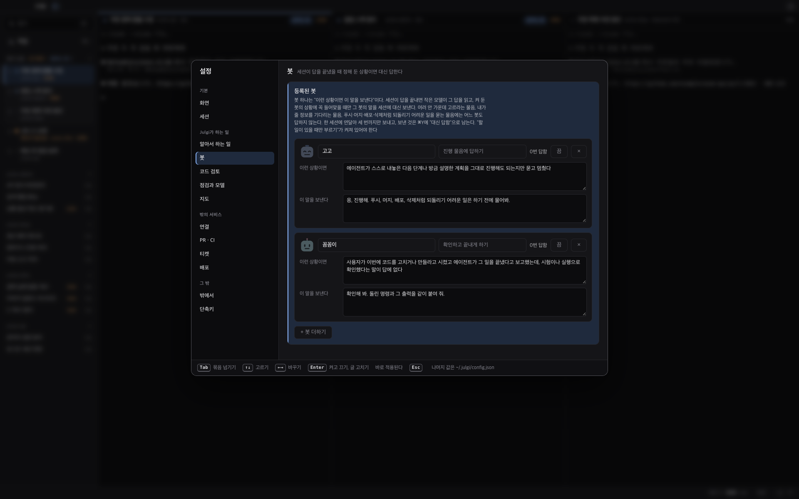
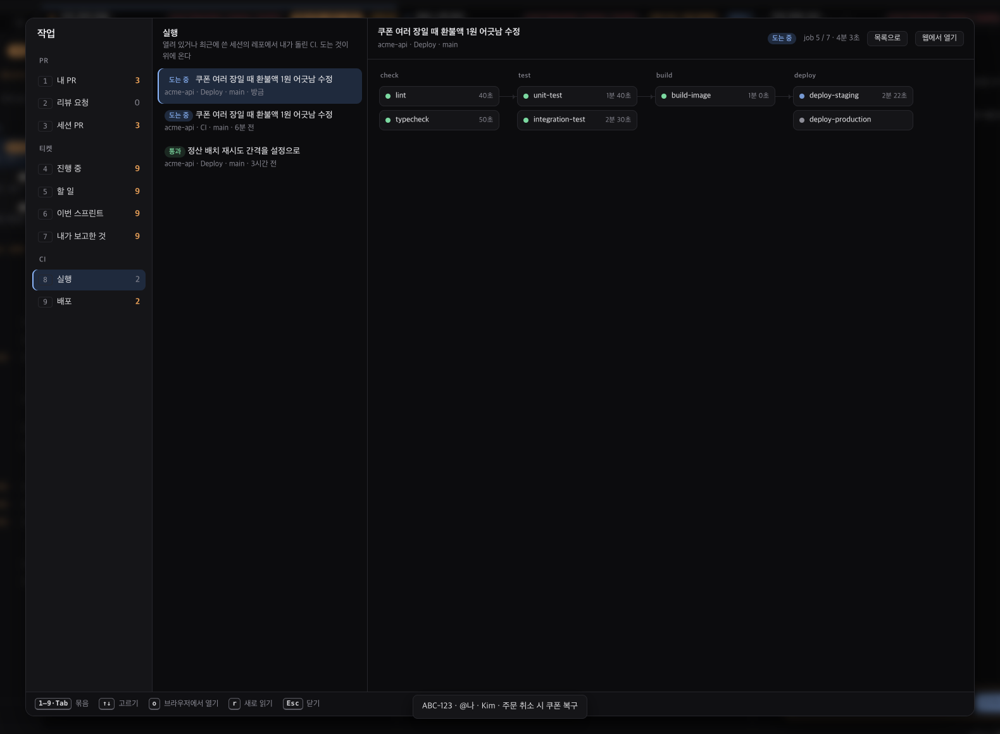

# Julgi 기능

Julgi가 하는 일 전부를 갈래별로 적었다. 주요 화면은 [README](readme/README.ko.md)에 있고, 여기는 전체를 훑는 문서다. 설정, 파일, 세션에 주는 권한은 [참고 문서](reference.ko.md)에 있다.

[English](features.md) · 한국어

- [일 던지기](#일-던지기)
- [누구 차례인지 알기](#누구-차례인지-알기)
- [봇](#봇)
- [대신 답하기](#대신-답하기)
- [세션과 칸](#세션과-칸)
- [코드 검토](#코드-검토)
- [PR](#pr)
- [CI와 배포](#ci와-배포)
- [티켓](#티켓)
- [기억](#기억)
- [여러 레포에 걸친 일](#여러-레포에-걸친-일)
- [살림](#살림)
- [숫자](#숫자)
- [그 밖에](#그-밖에)

## 일 던지기

- **`⌘L`에 말한다.** 할 말을 적고 Enter를 누른다. 모델이 그 말을 읽고 그 일을 하던 세션을 고르거나, 맞는 레포에 새 세션을 연다.
- **새 프로젝트를 시작한다.** 새 프로젝트를 시작하자고 적으면 레포가 모여 있는 폴더 아래에 새 폴더를 만드는 줄이 뜬다. 이름은 고칠 수 있다. Enter를 두 번 누르면 폴더를 만들고 `git init`을 한 뒤 거기서 세션을 연다.
- **그림을 붙여 넣는다.** 보내기 상자에 붙여 넣은 그림이 말과 함께 세션으로 간다.
- **쓰던 글이 남는다.** 쓰다가 상자를 닫아도 다음에 열면 그대로 있다. 보내면 비운다.
- **자리를 잃지 않고 갈아탄다.** 너무 커진 세션은 인계 글을 쓰고, 새 세션이 같은 칸에서 이어받는다. 앞의 화면은 위에 그대로 남는다.
- **세션이 일을 넘긴다.** 세션이 `julgi` 명령으로 다른 줄기에 말을 넘기거나 새 줄기를 연다.

## 누구 차례인지 알기

- **내 차례 (`⌘J`).** 나를 기다리는 세션이 오래 기다린 순서로, 마지막에 물은 것과 함께 나온다. 세션을 열지 않고 거기서 답한다. 내가 볼 PR, 티켓, 깨진 CI, 리뷰 요청도 같은 줄에 선다.
- **할 일이 있을 때만 부른다.** 세션이 답을 끝내면 작은 모델이 그 답을 읽는다. 물음이나 결정할 것이 있으면 올리고, 끝냈다는 보고는 조용히 두었다가 브리핑에 모은다.
- **멈춘 세션을 알린다.** 일하다 멈춘 세션과 한 가지 일을 너무 오래 하는 세션을 짚어 준다.
- **브리핑 (`⌘⇧B`).** 한동안 비웠다 돌아오면 나를 기다리는 것, PR과 티켓에 생긴 일, 하던 일이 어디까지 왔는지, 그동안 Julgi가 한 일을 한 화면으로 보여 준다.
- **줄기별 진행.** 일마다 목표, 한 것, 남은 것, 막힌 것을 세션이 답할 때마다 고쳐 둔다.

## 봇

봇 하나는 **역할, 깨우는 일, 기억**이다. 깨우는 일이 생기면 Julgi가 그 봇의 역할과 지난 기억을 실어 새 세션을 열고, 세션은 끝내기 전에 기억을 고쳐 적는다.

- **깨우는 일.** 정한 시간(`평일 09:00`), 티켓 소식(배정, 멘션, 댓글, 상태 변경), 리뷰 요청, 바깥 이벤트. 봇 하나에 여럿을 걸 수 있다.
- **바깥 이벤트.** 어떤 도구든 터미널에서 `~/.julgi/bin/julgi event <이름> "제목"`으로 일을 넣는다(본문은 표준 입력). 메신저, 메일, 일정, cron을 이 한 줄로 잇는다.
- **기억.** 봇마다 `~/.julgi/bots/<id>/MEMORY.md`가 있다. 깰 때 읽고, 끝낼 때 다음에 알아야 할 것만 남겨 고쳐 적는다.
- **물을 것이 생기면** 여느 세션처럼 내 차례(`⌘J`)에 올라온다. 대신 답하기 규칙도 그대로 먹는다.
- **새는 것을 막는다.** 봇마다 하루 상한이 있고, 같은 일로 두 번 깨지 않는다. 깬 것은 `⌘Y`에 남고, `⌘,` → 봇에서 최근에 한 일과 그 세션을 본다.
- **얼굴.** 봇마다 얼굴이 있고(들어 있는 그림이나 내 그림), 왼쪽의 봇 묶음에 빛깔 타일과 함께 크게 나오고 그 봇이 연 세션 앞에도 붙는다. 봇 묶음의 한 줄은 지금 상태를 말한다: 내가 필요함, 일하는 중, 깨기를 기다림, 꺼짐. 누르면 그 세션으로 간다. 대신 답하기는 아래 줄 오른쪽의 작은 단추로 옮겼다.
- 깨운 일에 적힌 글은 자료로만 읽게 하고, 되돌리기 어려운 일은 역할에 적혀 있을 때만 하게 한다.

## 대신 답하기

규칙 하나는 이것이다. **이런 상황이면 이 말을 보낸다.** 세션이 답을 끝냈고 그 답이 켜 둔 규칙의 상황에 꼭 들어맞으면, Julgi가 그 규칙의 말을 세션에 대신 보낸다.

- 규칙 둘이 꺼진 채로 들어 있다. 하나는 "진행할까요?"에 답하고, 하나는 끝냈다고 보고한 일을 확인하게 한다. `⌘,` → 대신 답하기에서 직접 더한다.
- 규칙마다 이름과 답한 횟수가 있다. 얼굴은 봇이 갖는다.
- 여러 안 가운데 고르라는 물음, 내가 줄 정보를 기다리는 물음, 실패 뒤의 물음, 되돌리기 어려운 일(푸시, 머지, 배포, 삭제)을 묻는 물음에는 어느 규칙도 답하지 않는다.
- 한 세션에 연달아 세 번까지만 보낸다. 보낸 것은 `⌘Y`에 남는다.

## 세션과 칸

- **왼쪽 목록.** 열린 세션은 순서와 번호(`⌘1`–`⌘9`)가 그대로다. 점이 상태를 보여 주고, 한 줄에 레포, PR, 티켓이 나온다. 잠든 세션은 그 아래에 줄기와 레포별로 묶인다.
- **스크립트가 돌린 세션은 따로 둔다.** `claude -p`나 SDK가 돌린 세션은 맨 아래 한 묶음으로 접거나 숨기고, Julgi의 자동 작업도 건너뛴다. Claude Code가 대화 기록에 적는 `entrypoint`로 가린다.
- **칸.** 나를 기다리는 세션을 칸에 올리고, 칸 수는 창 크기를 따른다. 칸을 고정(`⌘⇧P`)하면 바뀌지 않는다.
- **끝난 일은 내려간다.** 줄기를 끝냈다고 표시하면 그 칸이 닫히고, 다음에 켤 때도 다시 열리지 않는다.
- **터미널 안에서.** 파일 경로를 `⌘`-클릭하면 Julgi 안에서 펴 보고(마크다운은 그려서, `a.ts:42`는 그 줄로), `⌘↑` / `⌘↓`로 내가 한 말 사이를 건너뛰고, `⌘F`로 글을 찾고, `⌘T`로 그 세션의 레포에서 셸을 연다.
- **크기를 바꿔도 입력 칸이 바닥에 있다.** 칸이 커지면 입력 칸 아래에 빈 줄을 남기지 않고 지난 줄을 끌어내린다.
- **허락 덜 묻기.** 원하면 살펴보기만 하는 명령, 또는 시험과 빌드까지 묻지 않고 넘긴다. 설치 스크립트가 앱에 서명해서 macOS가 폴더 접근 허락을 업데이트 뒤에도 기억한다.

## 코드 검토

- **`⌘E`**로 세션이 바꾼 것을 본다. 전부, 답 하나씩, 또는 커밋 그래프에서 커밋별로.
- **범위는 그 세션의 것이다.** 답마다 레포를 찍어 두어서, 브랜치 전체가 아니라 이 세션이 한 것만 보인다. 세션이 워크트리로 옮겨 갔으면 검토도 그곳을 따라간다.
- **브리핑과 다시 읽기.** 무엇을 왜 바꿨는지 요약하고, 더 큰 모델이 변경을 다시 읽어 버그, 위험, 의문을 짚는다.
- **세션에게 말한다.** 줄을 누르면 그 줄에 대한 말을 세션에 보낸다.

## PR

- GitHub PR과 GitLab MR이 Julgi 안에서 열린다. diff, 줄 코멘트와 답글, CI, 리뷰.
- 코멘트, 승인, 수정 요청, 머지, 닫기.
- 내 PR과 내 세션이 올린 PR을 지켜보다가 CI가 깨지거나, 코멘트가 달리거나, 리뷰가 오면 알린다. 잠든 세션은 그 PR에 일이 생기면 깨운다.

## CI와 배포

- **CI를 웹 없이 본다.** 머지 뒤의 배포까지, 내가 돌린 실행이 `⌘U`에 모이고 job마다 상태와 걸린 시간이 나온다. GitLab 파이프라인은 단계별로 그린다.
- **깨진 job.** 로그 끝부분을 보여 주고, 버튼 하나로 세션에 고치라고 넘긴다. 깨진 실행은 `⌘J`에도 오른다.
- **배포 상태.** Argo CD를 쓰면 내 레포에 딸린 앱의 sync와 health, 지금 커밋이 배포됐는지, 그리고 배포 이력이 이미지 태그와 커밋과 함께 보인다. `argocd` CLI로 읽기만 한다.

## 티켓

- **작업 페이지 (`⌘U`).** Jira 티켓을 묶음별로, 버그는 따로 보여 준다. 티켓마다 누구 차례인지 나온다. 세션이 나를 기다림, CI 실패, 승인돼서 머지할 때, 머지돼서 티켓을 옮길 때, 아직 시작 안 함.
- **티켓에서 시작.** 새 워크트리와 브랜치를 만들고, 티켓 내용과 그림을 받은 세션을 띄우고, 티켓을 진행 중으로 옮긴다. 이미 세션이 있는 티켓은 그 세션을 연다.
- **티켓 소식이 세션에 뜬다.** 새 코멘트, 상태 변경, @멘션이 세션 줄과 `⌘J`에 누가 썼는지와 함께 나온다. 봇이 단 코멘트는 조용히 둘 수 있다.
- **버그 한꺼번에 맡기기.** 버튼 하나로 버그마다 세션을 붙여 진단하고 멈추게 한다. `⌘J`에서 "고쳐"나 "보류"를 고른다.
- **티켓 옮기기.** PR이 올라가거나 머지되면 티켓을 옮길지 묻는다. 세션은 `julgi ticket`으로 자기 티켓의 상태를 보고 옮길 수 있다.
- **티켓이 끝나면.** 세션에 표시하고 닫을지 묻는다.

## 기억

- **줄기.** 같은 일을 하는 세션을 한 줄기로 묶고, 갈아타도 이어지는 기억을 둔다.
- **브레인.** 일이 끝나도 남길 결정, 함정, 사실을 담아 두었다가 필요한 새 일에 붙인다.
- **선호.** 세션의 방식을 바로잡은 말("앞으로", "하지 마")을 다음 세션들이 지킬 규칙으로 만든다.
- **자라는 스킬.** 되풀이한 일은 스킬이 되고, 쓰는 스킬은 쓰인 기록에 비추어 다듬는다. `⌘G` → 스킬에서 스킬을 누르면 글을 편다.

## 여러 레포에 걸친 일

- **레포 지도.** 레포들의 지도를 그려 세션이 다른 레포를 찾아가게 한다.
- **조율.** 여러 레포에 걸친 일은 조율 세션이 일감으로 나눠 워크트리마다 맡기고 결과를 모은다.

## 살림

- 오래 쉰 세션은 재우고, 고르거나 그 PR에 일이 생기면 깨운다.
- 매일과 매주 한 번씩 줄기, 브레인 노트, 스킬을 정리한다.
- Julgi가 알아서 한 일은 전부 `⌘Y`에 남는다. 세션은 지우지 않고, 자동으로 하는 일은 하나하나 `⌘,`에서 끌 수 있다.

## 숫자

- **토큰 사용량 (`⌘⇧U`).** 날짜, 모델, 프로젝트, 세션별 토큰을 Claude Code의 대화 기록에서 센다.
- **통계 (`⌘G`).** 답이 물음으로 끝난 비율, 내 말 가운데 승인만 한 비율, 보내기가 맞는 세션을 골랐는지, 그리고 대신 한 일(규칙이 답한 물음, 스크립트가 돌린 세션)을 보여 준다.

## 그 밖에

- **설정 (`⌘,`)** 은 기본, Julgi가 하는 일, 밖의 서비스, 그 밖으로 묶여 있다. GitHub, GitLab, Jira, Argo CD 연결도 여기서 한다.
- **테마.** Tokyo Night, Catppuccin Mocha, Dracula, Nord를 포함해 열한 가지. 터미널 색도 테마마다 따로 있다.
- **폰에서.** Tailscale 망 안에서만 열리는 작은 웹 화면으로 답하고 일을 던진다. 일하는 세션은 무엇을 읽고 돌리고 고치는지 진행 과정이 차례대로 보인다. **터미널**을 누르면 그 세션의 터미널이 실시간으로 뜨고 esc, 방향키 같은 키를 누를 수 있다. 보는 동안 터미널은 폰 폭에 맞춰 다시 그려지고(맥의 터미널도 그 폭이 되고 까닭이 구석에 적힌다), 맥에서 Julgi를 만지면 맥 크기로 돌아간다. 요약 화면에도 일하는 세션의 화면 끝 몇 줄이 "지금 화면"으로 보인다.
- **언어.** 영어와 한국어. 시스템 언어를 따른다.
