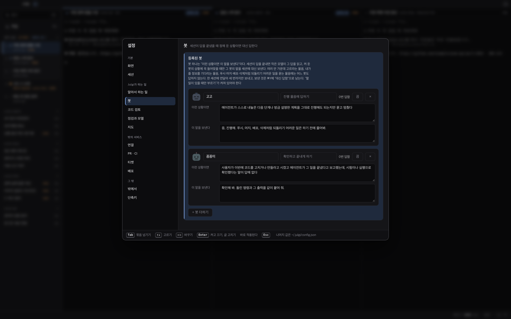
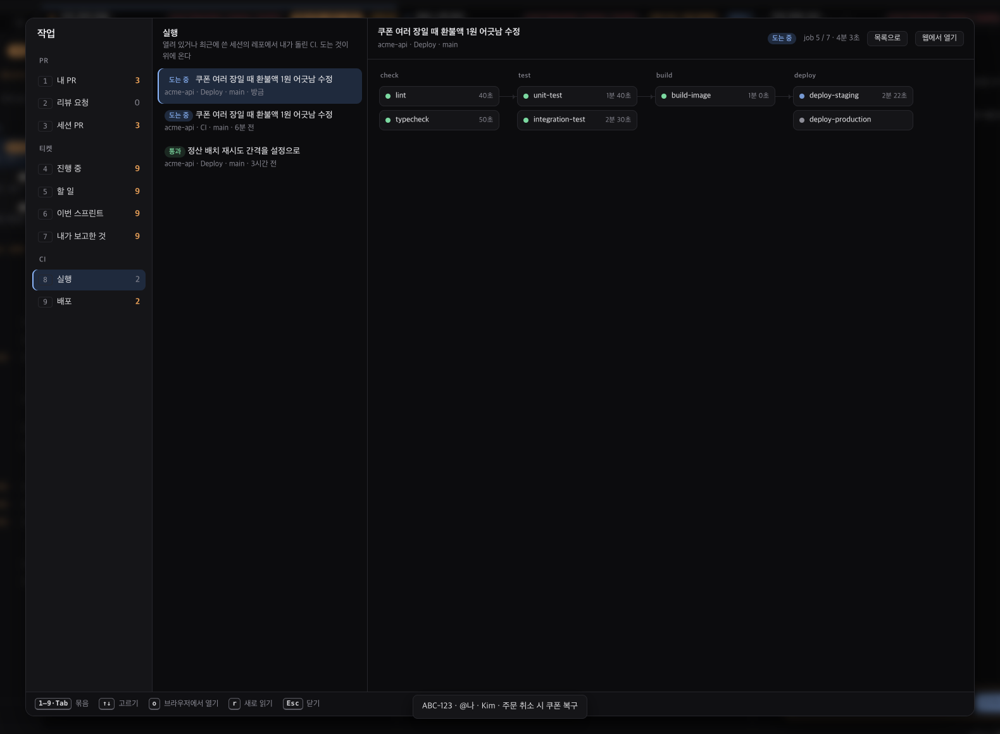

# Julgi features

Everything Julgi does, by area. The [README](../README.md) shows the main screens; this page is the full tour. Settings, files and what Julgi grants its sessions are in the [reference](reference.md).

English · [한국어](features.ko.md)

- [Sending work](#sending-work)
- [Knowing whose turn it is](#knowing-whose-turn-it-is)
- [Bots](#bots)
- [Sessions and panes](#sessions-and-panes)
- [Code review](#code-review)
- [Pull requests](#pull-requests)
- [CI and deploys](#ci-and-deploys)
- [Tickets](#tickets)
- [Memory](#memory)
- [Work across repos](#work-across-repos)
- [Housekeeping](#housekeeping)
- [Numbers](#numbers)
- [The rest](#the-rest)

## Sending work

- **Say it in `⌘L`.** Type what you want and press Enter. A model reads the message and picks the session that was already doing that work, or opens a new one in the right repo.
- **Start a new project.** Write that you are starting a new project and a row offers a new folder under your repo root, with a name you can change. Enter twice makes the folder, runs `git init` and opens the session there.
- **Paste a picture.** An image pasted into the send box goes to the session with the message.
- **The draft stays.** Close the box mid-sentence and the text is still there next time; it is cleared when you send.
- **Hand-off without losing your place.** A session that has grown too large writes a brief and a fresh session takes over in the same pane, with the earlier screen still above it.
- **Sessions can pass work on.** A session can hand a message to another stem or start a new one through the `julgi` command.

## Knowing whose turn it is

- **My turn (`⌘J`).** Every session waiting on you, oldest first, with the question it ended on. Answer there without opening the session. PRs, tickets, failed CI runs and review requests that need you are in the same queue.
- **Only called when needed.** When a session finishes, a small model reads the reply. A question or a decision brings it up; a plain "done" stays quiet and is collected in the briefing.
- **Stalls are flagged.** A session that stops mid-work, or runs one request for too long, is pointed out.
- **Briefing (`⌘⇧B`).** Come back after a while and one screen shows what is waiting, news on PRs and tickets, where each piece of work stands, and what Julgi did meanwhile.
- **Progress per stem.** Goal, done, left and blocked for each piece of work, kept up to date as sessions reply.

## Bots

A bot is one rule: **in this situation, send this message.** When a session finishes a reply and the reply clearly matches the situation of a bot that is on, Julgi sends the bot's message to the session for you.

- Two bots come registered and switched off: one answers "shall I go on?", one asks a session to verify work it reported as done. Add your own in `⌘,` → Bots.
- Each bot has a name, a face (drawn by Julgi, or a picture you choose), and a count of how often it answered.
- No bot answers a question that asks you to choose between options, waits for information from you, follows a failure, or is about something hard to undo (push, merge, deploy, delete).
- At most three bot messages in a row go to one session. Each one is listed in `⌘Y`.

## Sessions and panes

- **Sidebar.** Open sessions keep their order and number (`⌘1`–`⌘9`); a dot shows the state, and one line shows the repo, PR and ticket. Sleeping sessions are grouped by stem and repo below.
- **Sessions run by scripts are kept apart.** Sessions started by `claude -p` or the SDK are folded into one group at the bottom, or hidden, and Julgi's own work skips them. Julgi tells them by the `entrypoint` Claude Code writes into the transcript.
- **Panes.** Sessions waiting on you are brought into panes and the pane count follows the window. Pin a pane (`⌘⇧P`) to keep it.
- **Finished work leaves.** When a stem is marked done its panes close and are not restored at next launch.
- **In the terminal.** `⌘`-click a file path to read it inside Julgi (markdown is rendered, `a.ts:42` jumps to the line), `⌘↑` / `⌘↓` jump between your own messages, `⌘F` finds text, and a shell for the session's repo opens with `⌘T`.
- **Resizing keeps the prompt at the bottom.** When a pane grows, earlier lines are pulled down instead of leaving empty rows under the input.
- **Fewer permission prompts.** Optionally let read-only commands, or tests and builds too, through without asking. The install script signs the app so macOS remembers folder access across updates.

## Code review

- **`⌘E`** shows what the session changed: everything, one reply at a time, or commit by commit on a graph.
- **The range is the session's own.** Julgi snapshots the repo at each reply, so the diff is what this session did, not everything on the branch. If the session moved to a worktree, the review follows it there.
- **Briefing and second read.** A summary of what changed and why, then a larger model rereads the change and marks bugs, risks and open questions.
- **Tell the session.** Click a line to send a comment about it to the session.

## Pull requests

- GitHub PRs and GitLab MRs open inside Julgi: diff, line comments and replies, CI, reviews.
- Comment, approve, request changes, merge, close.
- Julgi watches your PRs and the ones your sessions opened, and tells you when CI breaks, someone comments or a review lands. A sleeping session is woken when its PR has news.

## CI and deploys

- **CI runs without the browser.** The runs you started, including a deploy after a merge, are listed in `⌘U` with each job's state and time. GitLab pipelines are drawn stage by stage.
- **Failed jobs.** The end of the log is shown, and one button hands it to a session to fix. A failed run also goes to `⌘J`.
- **Deploy status.** If you use Argo CD, the apps that belong to your repos show sync and health, whether the commit you are on has been deployed, and the history of deploys with each one's image tag and commit. Read-only, through the `argocd` CLI.

## Tickets

- **Work page (`⌘U`).** Jira tickets by group, bugs listed apart from the rest, each with whose move it is: a session waiting on you, CI failed, approved and ready to merge, merged and time to move the ticket, or not started.
- **Start from a ticket.** A new worktree and branch, a session briefed with the ticket and its images, and the ticket moved to In Progress. A ticket that already has a session opens that session.
- **Ticket news on the session.** A new comment, a status change or an @mention shows on the session's row and in `⌘J`, with who wrote it. Bot comments can be kept quiet.
- **Hand over all bugs.** One button gives every bug to a session that diagnoses and stops; you choose "fix it" or "hold" in `⌘J`.
- **Moving the ticket along.** When the PR goes up or merges, Julgi offers to move the ticket. A session can check and move its own ticket with `julgi ticket`.
- **When a ticket ends.** The session is marked and offered for closing.

## Memory

- **Stems.** Sessions doing the same work are joined into one stem, with a memory that carries over hand-offs.
- **Brain.** Decisions, pitfalls and facts worth keeping are saved when work ends and attached to new work that needs them.
- **Preferences.** When you correct a session ("from now on…", "don't…"), Julgi turns it into a rule every later session follows.
- **Skills that grow.** Work you repeat becomes a skill; skills you use are refined from how they were used. Click a skill in `⌘G` → Skills to read it.

## Work across repos

- **Repo map.** Julgi draws a map of your repos so a session can find its way into another one.
- **Coordinator.** Work that spans repos gets a lead session that splits it into tasks, each in its own worktree, and collects the results.

## Housekeeping

- Idle sessions are put to sleep, and woken when you pick them or their PR has news.
- A daily and a weekly pass tidy stems, brain notes and skills.
- Everything Julgi did on its own is listed in `⌘Y`. Sessions are never deleted, and each automatic behavior can be turned off in `⌘,`.

## Numbers

- **Token usage (`⌘⇧U`).** Tokens by day, model, project and session, counted from Claude Code's transcripts.
- **Statistics (`⌘G`).** How often replies end in a question, how much of what you say is only approval, whether routing picked the right session, and what was done for you: questions bots answered and sessions run by scripts.

## The rest

- **Settings (`⌘,`)** are grouped: basics, what Julgi does, outside services, the rest. Each connection (GitHub, GitLab, Jira, Argo CD) is set up there.
- **Themes.** Eleven, including Tokyo Night, Catppuccin Mocha, Dracula and Nord, each with its own terminal colors.
- **From your phone.** A small web view, reachable only inside your Tailscale network, to answer and send work. A working session shows its steps as they happen: what it reads, runs and edits.
- **Languages.** English and Korean; it follows the system language.
