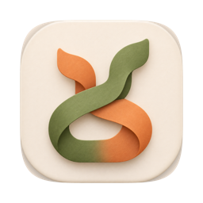
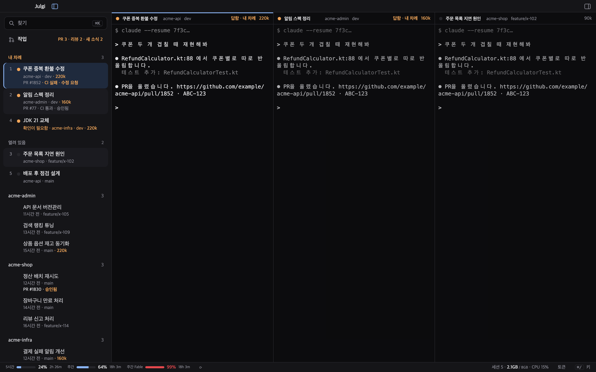
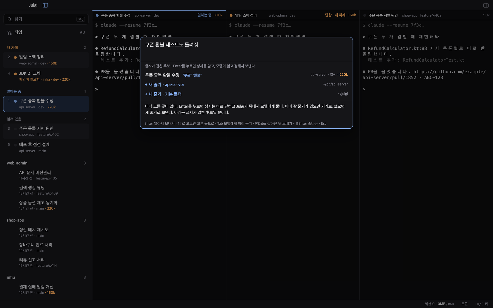
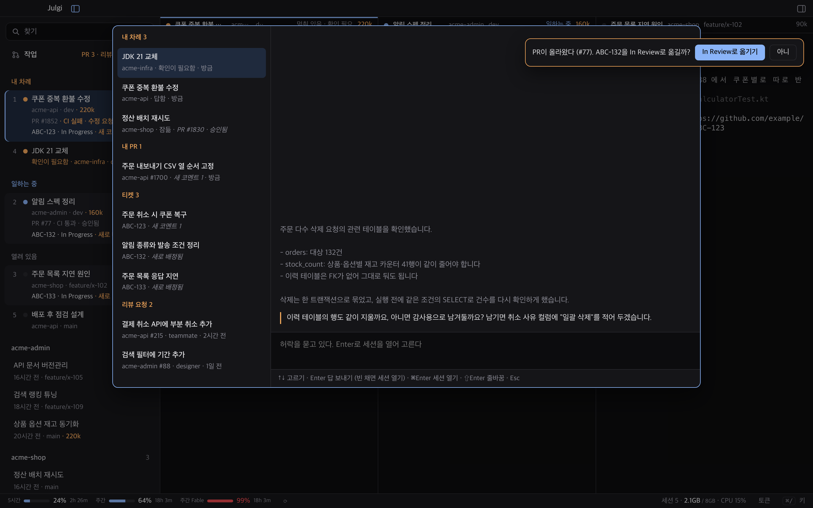
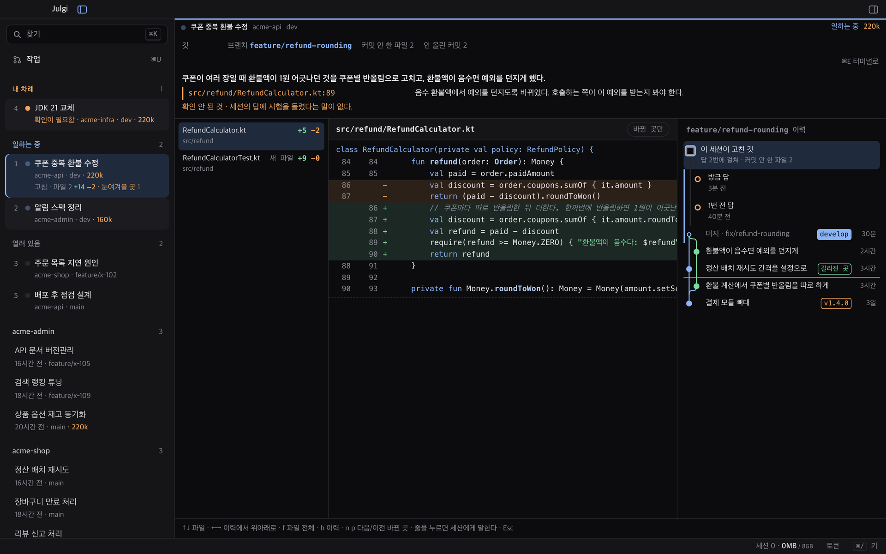
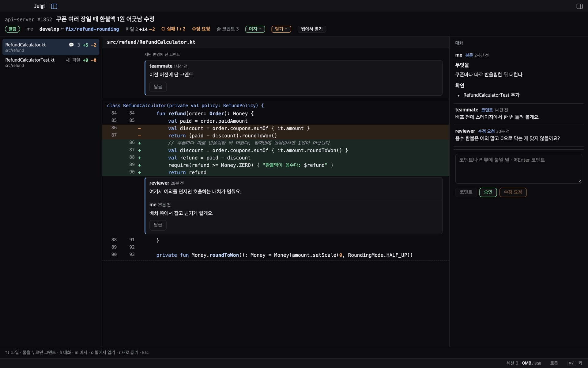
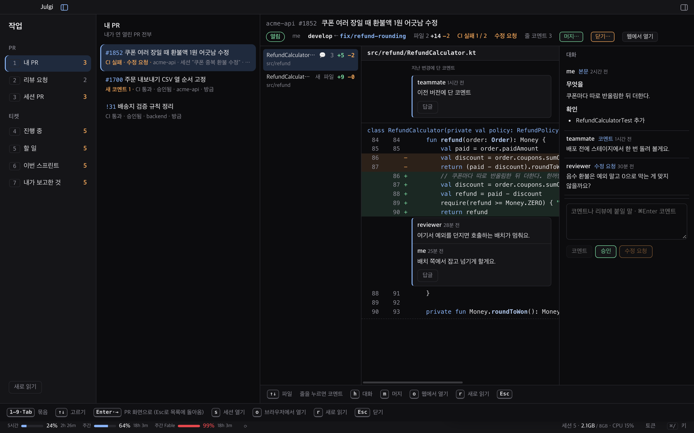
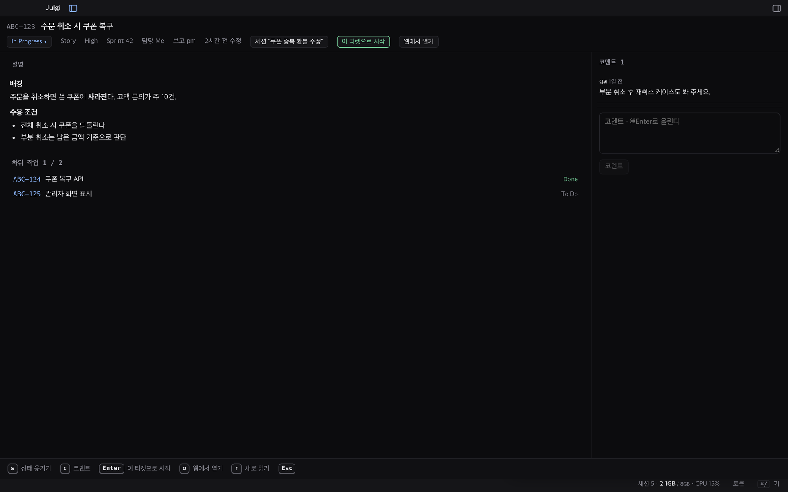
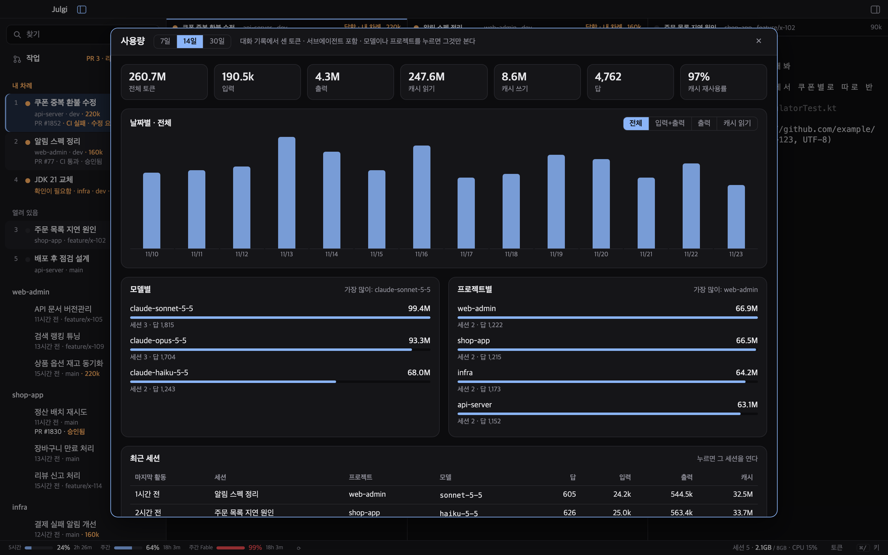

<h1 align="center"><br />Julgi</h1>

<p align="center"><b>やりたいことを言うだけ。セッションの面倒は Julgi が見ます。</b></p>

<p align="center">
  
  
  
  
</p>

<p align="center"><sub><a href="../../README.md">English</a> · <a href="README.ko.md">한국어</a> · 日本語 · <a href="README.zh-CN.md">简体中文</a></sub></p>

<p align="center">
  複数の <a href="https://claude.com/claude-code">Claude Code</a> セッションを 1 つのウィンドウに並べ、<br />
  メッセージをどのセッションに送るか、いま自分が見るべきものは何かを代わりに判断する macOS アプリです。
</p>

<p align="center"></p>

*Julgi*（줄기、「ジュルギ」）は韓国語で植物の茎のことです。このアプリでは、1 つの仕事とそれを引き継いできたセッションのつながりを **茎（stem）** と呼びます。

> [!NOTE]
> UI は英語と韓国語です（システムの言語に従い、`⌘,` で変えられます）。macOS でしか使っていません。署名済みインストーラはなく、自分でビルドします（スクリプト 1 つ）。

## なぜ作ったか

エージェントでいくつかのプロジェクトを回していると、リポジトリが複数、それぞれにタブが複数、タブごとにセッションが複数、という状態になります。すると、どのセッションが何をしていたか、どれが自分を待っているか、どれは忘れてよいかを、自分で覚えておくことになります。注意を散らすのは仕事そのものではなく、この帳簿づけです。

その帳簿を Julgi が引き受けます。**自分は仕事を投げるだけで、セッションの面倒は Julgi が見ます。** メッセージの送り先を選び、対応が必要なものだけを前に出し、休んでいるセッションは眠らせ、同じ仕事のセッションをまとめ、複数のリポジトリにまたがる仕事は複数のセッションに分けて結果を集めます。

## 機能

<table>
<tr>
<td width="42%">

### 言うだけ — `⌘L`

やりたいことを入力して Enter を押します。Julgi が内容を読み、その仕事をしていたセッションを選ぶか、適切なリポジトリで新しいセッションを開きます。大きくなりすぎたセッションは、引き継ぎメモを書いて新しいセッションに乗り換えてから送ります。

</td>
<td></td>
</tr>
<tr>
<td>

### 自分の番 — `⌘J`

自分を待っているセッションを、待ち時間の長い順に、最後の質問と一緒に表示します。セッションを開かずにその場で答えられます。対応が必要な PR やチケットも同じ列に並びます。

</td>
<td></td>
</tr>
<tr>
<td>

### コードレビュー — `⌘E`

セッションが変更した内容を見ます。全部、返信ごと、またはコミットグラフ上のコミットごと。Julgi が何をなぜ変えたかを要約し、より大きなモデルで読み直します。行をクリックすると、その行についてセッションに伝えられます。

</td>
<td></td>
</tr>
<tr>
<td>

### ブラウザなしで PR

GitHub の PR と GitLab の MR を Julgi の中で開きます。diff、行コメントと返信、CI、レビューを見て、コメント、承認、修正依頼、マージ、クローズができます。自分の PR を見張り、CI が落ちたり、コメントが付いたり、レビューが来たら知らせます。

</td>
<td></td>
</tr>
<tr>
<td>

### 作業ページ — `⌘U`

すべてを 1 か所で見渡せます。自分の PR、レビュー依頼、セッションが出した PR、グループ別の Jira チケット。選ぶと右側に PR やチケットが開きます。

</td>
<td></td>
</tr>
<tr>
<td>

### チケットから始める

Jira チケットを Julgi の中で開き、「このチケットで開始」を押します。新しいワークツリーとブランチを作り、チケットの内容を渡されたセッションが立ち上がり、チケットは In Progress に移ります。PR が出たりマージされたりすると、チケットを次の状態に移すか尋ねます。

</td>
<td></td>
</tr>
<tr>
<td>

### トークンの行き先 — `⌘⇧U`

日付、モデル、プロジェクト、セッションごとのトークンを Claude Code の会話ログから数えます。モデルやプロジェクトをクリックすると、それだけに絞り込めます。

</td>
<td></td>
</tr>
</table>

### ほかにも

- **ブリーフィング** — しばらく離れて戻ると、自分を待っているもの、PR とチケットの動き、進行中の仕事の状況、その間に Julgi がしたことを 1 画面で見せます（`⌘⇧B`）。
- **茎ごとの進み具合** — 仕事ごとに目標、済んだこと、残り、止まっていることを、セッションが返信するたびに更新します。
- **許可の確認を減らす** — 望めば、見るだけのコマンド、あるいはテストやビルドまでを確認なしで通します。
- **茎** — 同じ仕事をしているセッションを 1 本の茎にまとめ、終わった仕事は一覧から下げます。
- **ブレイン** — 仕事が終わっても残すべき決定、落とし穴、事実を保存し、必要な新しい仕事に添えます。
- **好み** — セッションのやり方を正した言葉（「これからは」「しないで」）を、以降のセッションが守るルールにします。
- **リポジトリ地図** — リポジトリの地図を描き、セッションがほかのリポジトリをたどれるようにします。
- **コーディネーター** — 複数のリポジトリにまたがる仕事は、リードセッションがタスクに分け、それぞれ専用のワークツリーで進めます。
- **育つスキル** — 繰り返した作業はスキルになり、使われたスキルは使用記録をもとに磨かれます。
- **片付け** — 長く休んでいるセッションは眠らせ、選んだときやその PR に動きがあったときに起こします。
- **スマホから** — Tailscale ネットワーク内でだけ開く小さな Web 画面で、返信したり新しい仕事を投げたりできます。

判断が必要な場面（送り先、同じ仕事かどうか、何を残すか）は、文字列の一致ではなく内容を読んだモデルが決めます。Julgi が自動でしたことはすべて `⌘Y` に残り、セッションは削除されず、自動の動作はそれぞれ `⌘,` で切れます。

## インストール

macOS、Node 20 以上、Rust（stable）、`git`、そしてログイン済みの `claude` コマンドが PATH にあることが必要です。

```sh
git clone https://github.com/mangchhe/julgi.git && cd julgi
scripts/install.sh --open    # ツール確認 → ビルド → /Applications/Julgi.app → 起動
```

更新するときも同じコマンドを実行します。`scripts/install.sh --check` はツールの確認だけを行います。開発するなら `npm install && npm run tauri dev`。

連携には別途必要なものがあります。GitHub は [`gh`](https://cli.github.com)、GitLab は [`glab`](https://gitlab.com/gitlab-org/cli)、Jira は API トークン。`⌘,` → Connections でつなぎます。

## はじめかた

1. Julgi を開き、`⌘,` → Map でリポジトリが集まっているフォルダを指定します。
2. `⌘L` を押し、やってほしいことを入力して Enter。
3. セッションが自分を待つと「自分の番」に上がってきます。`⌘J` を押して答えます。

## 覚えておくキー

| キー | すること |
|---|---|
| `⌘L` | 言いたいことを投げる。送り先は Julgi が決める |
| `⌘J` | 自分の番：待っているセッション、PR、チケット、レビュー依頼 |
| `⌘K` | セッション検索。`pr` や `jira` と打つと PR やチケットを選べる |
| `⌘E` | 現在のセッションのコードレビュー |
| `⌘U` / `⌘⇧U` | 作業ページ / トークン使用量 |
| `⌘G` | 茎、ブレイン、スキル、統計、地図、git |
| `⌘Y` | Julgi が自動でしたこと |
| `⌘⇧B` | ブリーフィング：待っているもの、新着、仕事の状況 |
| `⌘T` / `⌘D` / `⌘W` | 新しいペインにシェル / ペインを追加 / 閉じる |

残りはアプリ内の `⌘/` にあります。

## しくみ

1. **セッションはターミナルで動くふつうの `claude` プロセスです。** Julgi はセッションの状態（作業中、待機、質問）をファイルに書くフックを付けて起動し、そのファイルを読みます。
2. **サーバーもデータベースもありません。** Julgi が知っていることはすべて `~/.julgi/` 以下のテキストファイルです。会話は Claude Code が置く場所にそのまま残ります。
3. **判断は `claude -p` で行います。** 送り先の選択、要約、ブリーフィング、片付けは、自分の Claude ログインで出ていく短いテキストだけの呼び出しです。

GitHub は `gh`、GitLab は `glab`、Jira は REST API を使い、Jira のトークンは macOS のキーチェーンに置きます。Webhook を受けるサーバーがないため、定期的に問い合わせます。

## Claude Code だけに対応している理由

Julgi は Codex CLI や Gemini CLI などのほかのエージェントを起動しません。Julgi が代わりにすること（誰の番かの判定、要約、乗り換え、セッションへの記憶の引き継ぎ）は、Claude Code のフック、会話ログ、起動オプションに依存しています。ほかの CLI はいまのところその一部にしか対応していません。半分しか面倒を見られないセッションがあると帳簿づけが自分に戻ってくるため、入れていません。対応が進めば見直します。

## リファレンス

セッションに与える権限、拡張ポイント、すべての設定、書き込むファイル、未対応の点は [docs/reference.md](../reference.md)（英語）にあります。使う前に権限の節を読んでください。

## コントリビュート

コミット規約とモックデータで画面を表示する方法は [CONTRIBUTING.md](../../CONTRIBUTING.md)（英語）にあります。

## ライセンス

MIT
