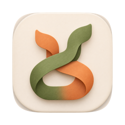
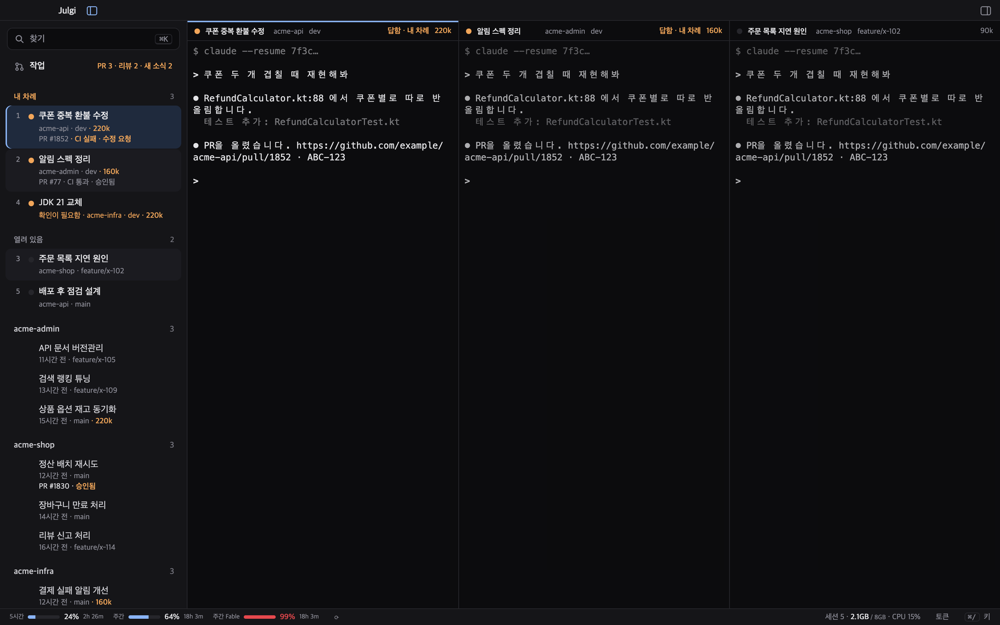
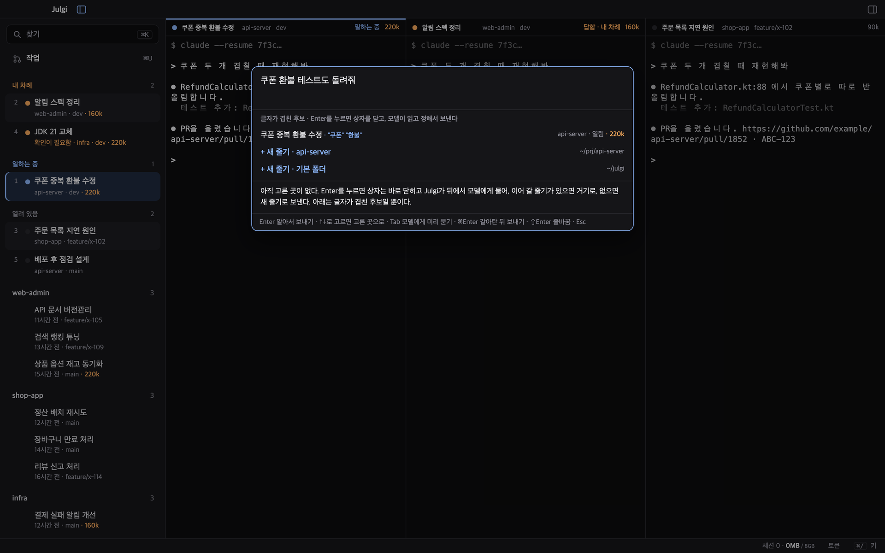
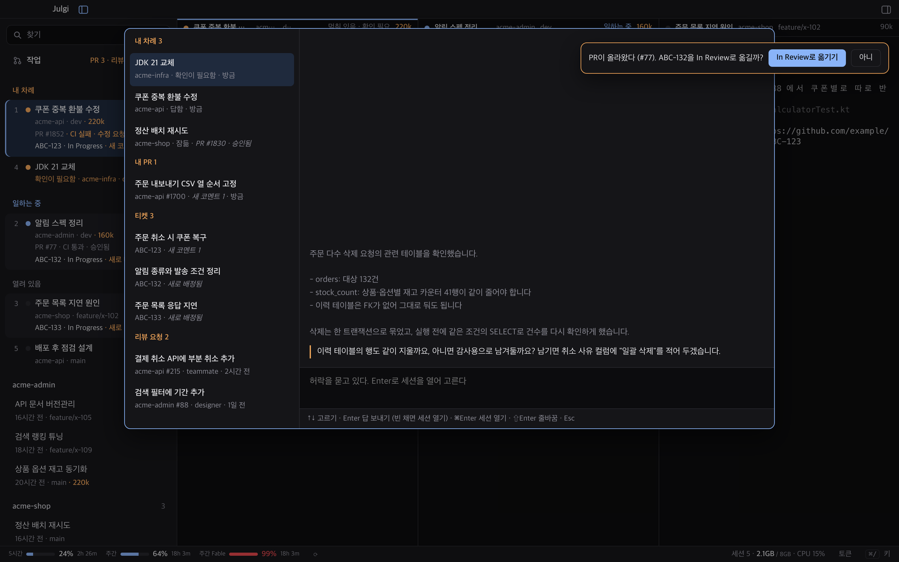
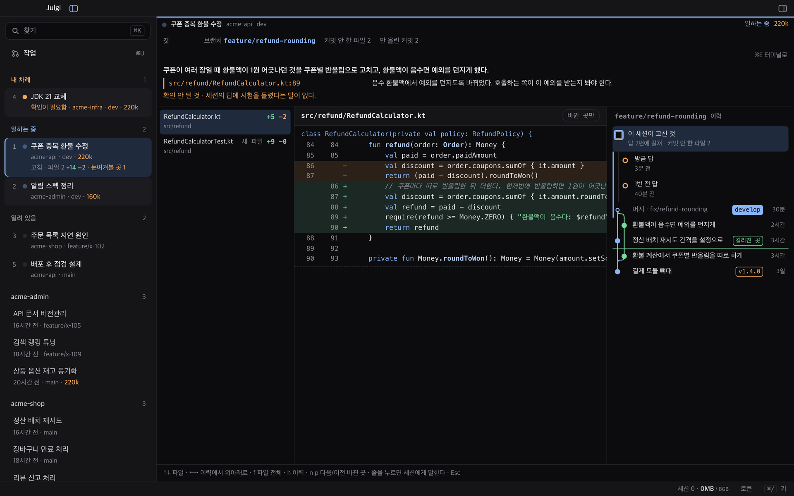
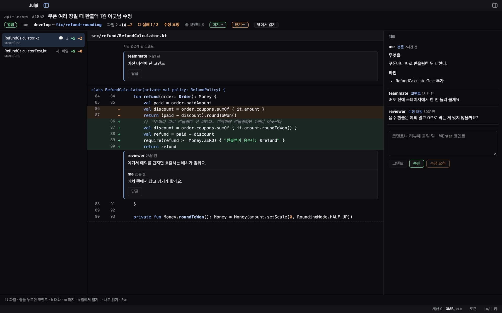
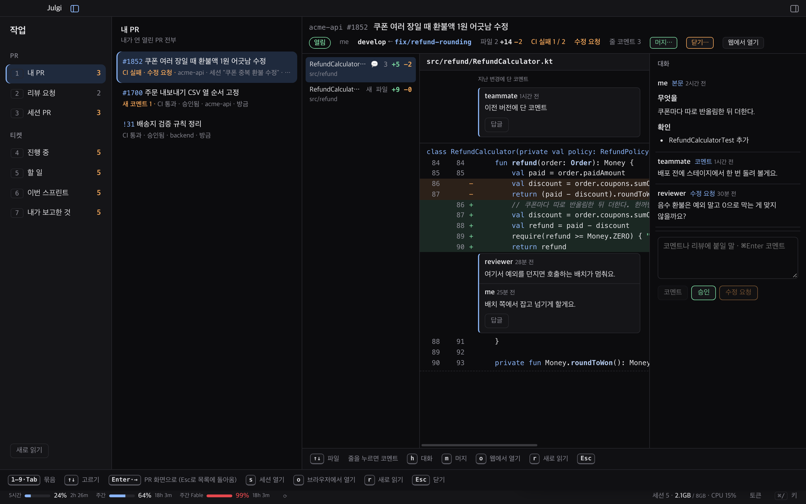
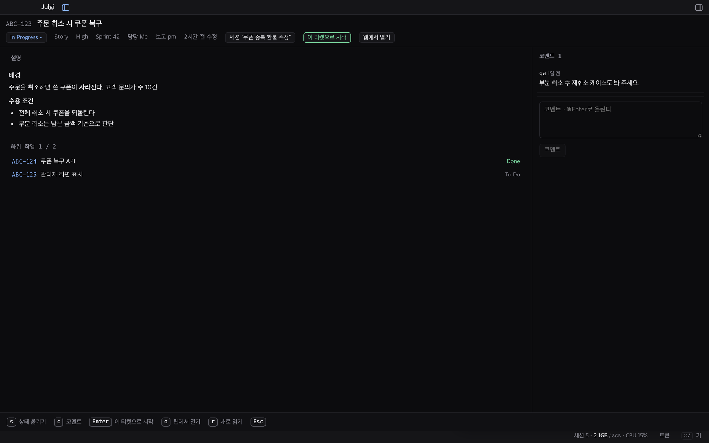
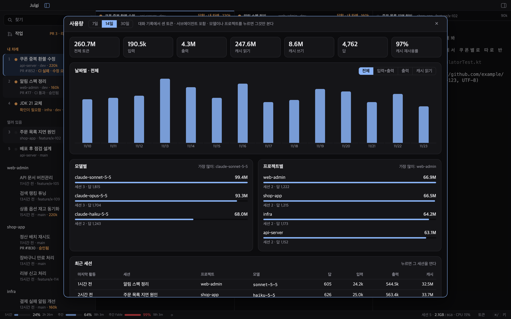

<h1 align="center"><br />Julgi</h1>

<p align="center"><b>할 말만 던지면, 세션은 Julgi가 돌본다.</b></p>

<p align="center">
  
  
  
  
</p>

<p align="center"><sub><a href="../../README.md">English</a> · 한국어 · <a href="README.ja.md">日本語</a> · <a href="README.zh-CN.md">简体中文</a></sub></p>

<p align="center">
  <a href="https://claude.com/claude-code">Claude Code</a> 세션 여러 개를 한 창에 나란히 띄워 놓고,<br />
  어느 세션에 무엇을 보낼지와 지금 무엇을 봐야 하는지를 대신 챙기는 macOS 앱.
</p>

<p align="center"></p>

*Julgi*(줄기, "jool-gi")는 식물의 줄기다. 이 앱에서 **줄기**는 일 하나, 그리고 그 일을 이어 온 세션들의 묶음이다.

> [!NOTE]
> UI는 영어와 한국어다(시스템 언어를 따르고 `⌘,`에서 바꾼다). macOS에서만 써 봤다. 서명된 설치 파일은 없어서 직접 빌드한다(스크립트 하나).

## 왜 만들었나

에이전트로 프로젝트 몇 개를 돌리다 보면 레포가 여러 개, 레포마다 탭이 여러 개, 탭마다 세션이 여러 개가 된다. 그러면 어느 세션이 뭘 하던 중인지, 어느 세션이 나를 기다리는지, 어느 것은 잊어도 되는지를 내가 기억하고 있어야 한다. 주의를 흩뜨리는 것은 일이 아니라 이 장부 정리다.

Julgi가 그 장부를 맡는다. **나는 일만 던지고, 세션은 Julgi가 돌본다.** 말이 갈 세션을 고르고, 내가 봐야 할 것만 올리고, 쉬는 세션은 재우고, 같은 일을 하는 세션을 묶고, 여러 레포에 걸친 일은 여러 세션에 나눠 맡긴 뒤 결과를 모은다.

## 기능

<table>
<tr>
<td width="42%">

### 할 말만 던진다 — `⌘L`

할 말을 치고 Enter를 누른다. Julgi가 글을 읽고 그 일을 하던 세션을 고르거나, 맞는 레포에 새 세션을 연다. 너무 커진 세션은 인계 글을 써서 새 세션으로 갈아탄 뒤 보낸다.

</td>
<td></td>
</tr>
<tr>
<td>

### 내 차례 — `⌘J`

나를 기다리는 세션을 오래 기다린 순서로, 마지막에 물은 말과 함께 보여 준다. 세션을 열지 않고 거기서 바로 답한다. 내가 봐야 할 PR과 티켓도 같은 줄에 선다.

</td>
<td></td>
</tr>
<tr>
<td>

### 코드 검토 — `⌘E`

세션이 고친 것을 본다. 전부, 답 하나씩, 또는 커밋 그래프에서 하나씩. Julgi가 무엇을 왜 바꿨는지 브리핑하고 더 큰 모델로 한 번 걸러 읽는다. 줄을 누르면 그 줄에 대해 세션에게 말한다.

</td>
<td></td>
</tr>
<tr>
<td>

### 브라우저 없이 PR

GitHub PR과 GitLab MR을 Julgi 안에서 연다. diff, 줄 코멘트와 답글, CI, 리뷰를 보고 코멘트, 승인, 수정 요청, 머지, 닫기를 한다. 내 PR을 지켜보다가 CI가 깨지거나 코멘트가 달리거나 리뷰가 오면 알린다.

</td>
<td></td>
</tr>
<tr>
<td>

### 작업 페이지 — `⌘U`

전부 한곳에서 둘러본다. 내 PR, 리뷰 요청, 세션이 올린 PR, 묶음별 Jira 티켓. 고르면 오른쪽에 PR이나 티켓이 열린다.

버그는 나머지와 나눠서 보여 주고, 버튼 하나로 전부 세션에 맡긴다. 세션은 진단만 하고 멈추며, "고쳐"와 "보류"는 `⌘J`에서 고른다.

티켓마다 지금 누가 무엇을 할 차례인지가 나온다. 그 티켓의 세션과 PR에서 Julgi가 아는 것으로 정한다: 세션이 나를 기다림, CI가 깨짐, 승인돼서 머지할 차례, 머지돼서 티켓을 옮길 차례, 시작 안 함. 내가 손댈 것이 위로 온다.

</td>
<td></td>
</tr>
<tr>
<td>

### 티켓에서 시작

Jira 티켓을 Julgi 안에서 열고 "이 티켓으로 시작"을 누른다. 새 워크트리와 브랜치를 따고, 티켓 내용을 들은 세션이 뜨고, 티켓은 In Progress로 옮긴다. PR이 올라오거나 머지되면 티켓을 다음 상태로 옮길지 묻는다.

</td>
<td></td>
</tr>
<tr>
<td>

### 토큰이 어디로 갔나 — `⌘⇧U`

날짜, 모델, 프로젝트, 세션별 토큰을 Claude Code의 대화 기록에서 센다. 모델이나 프로젝트를 누르면 그것만 본다.

</td>
<td></td>
</tr>
</table>

### 그 밖에

- **CI를 웹 없이 보기** — 머지 뒤의 배포까지, 내가 돌린 실행이 `⌘U`에 모이고 job마다 상태와 걸린 시간이 나온다. 깨진 job은 로그 끝부분을 보여 주고, 버튼 하나로 세션에 고치라고 넘긴다.
- **할 일이 있을 때만 부른다** — 세션이 답을 끝내면 작은 모델이 그 답을 읽는다. 물음이나 결정할 것이 있으면 내 차례로 올리고, 끝냈다는 보고는 조용히 두었다가 브리핑에서 모아 보여 준다. 일하다 멈춘 세션과 한 가지 일을 너무 오래 하는 세션은 따로 알린다.
- **브리핑** — 한동안 비웠다 돌아오면 나를 기다리는 것, PR과 티켓에 생긴 일, 하던 일이 어디까지 왔는지, 그동안 Julgi가 한 일을 한 화면으로 보여 준다(`⌘⇧B`).
- **줄기별 진행** — 일마다 목표, 한 것, 남은 것, 막힌 것을 세션이 답할 때마다 고쳐 둔다.
- **허락 덜 묻기** — 원하면 살펴보기만 하는 명령, 또는 시험과 빌드까지 묻지 않고 넘긴다.
- **줄기** — 같은 일을 하는 세션을 한 줄기로 묶고, 끝난 일은 목록에서 내린다.
- **브레인** — 일이 끝나도 남길 결정, 함정, 사실을 담아 두었다가 필요한 새 일에 붙인다.
- **선호** — 세션의 방식을 바로잡은 말("앞으로", "하지 마")을 다음 세션들이 지킬 규칙으로 만든다.
- **레포 지도** — 레포들의 지도를 그려 세션이 다른 레포를 찾아가게 한다.
- **조율** — 여러 레포에 걸친 일은 조율 세션이 일감으로 나눠 워크트리마다 맡긴다.
- **자라는 스킬** — 되풀이한 일은 스킬이 되고, 쓰는 스킬은 쓰인 기록에 비추어 다듬는다.
- **살림** — 오래 쉰 세션은 재우고, 고르거나 그 PR에 일이 생기면 깨운다.
- **테마** — 열한 가지. Tokyo Night, Catppuccin Mocha, Dracula, Nord도 있고 터미널 색까지 같이 바뀐다.
- **폰에서** — Tailscale 망 안에서만 열리는 작은 웹 화면으로 답하고 새 일을 던진다.

판단이 필요한 곳(보낼 곳, 같은 일인지, 무엇을 남길지)은 글자 겹침이 아니라 내용을 읽은 모델이 정한다. Julgi가 알아서 한 일은 전부 `⌘Y`에 남고, 세션은 지우지 않으며, 알아서 하는 것마다 `⌘,`에서 끌 수 있다.

## 설치

macOS, Node 20+, Rust(stable), `git`, 그리고 로그인된 `claude` 명령이 PATH에 있어야 한다.

<details>
<summary>없는 것이 있다면</summary>

```sh
xcode-select --install                                            # 컴파일러와 git
brew install node                                                 # 또는 https://nodejs.org
curl --proto '=https' --tlsv1.2 -sSf https://sh.rustup.rs | sh    # Rust, https://rustup.rs
npm install -g @anthropic-ai/claude-code && claude                # Claude Code, 그다음 로그인
```

`scripts/install.sh --check`가 아직 없는 것을 알려 준다.

</details>

```sh
git clone https://github.com/mangchhe/julgi.git && cd julgi
scripts/install.sh --open    # 도구 확인 → 빌드 → /Applications/Julgi.app → 실행
```

새 판으로 올릴 때도 같은 명령을 돌린다. `scripts/install.sh --check`는 도구만 확인한다. 고쳐 보려면 `npm install && npm run tauri dev`.

연동에는 따로 필요한 것이 있다. GitHub은 [`gh`](https://cli.github.com), GitLab은 [`glab`](https://gitlab.com/gitlab-org/cli), Jira는 API 토큰. `⌘,` → 연결에서 붙인다.

## 처음 쓰기

1. Julgi를 열고 `⌘,` → 지도에서 레포가 모여 있는 폴더를 정한다.
2. `⌘L`을 누르고 시킬 일을 친 뒤 Enter.
3. 세션이 나를 기다리면 "내 차례"로 올라온다. `⌘J`를 눌러 답한다.

## 알아 둘 키

| 키 | 하는 일 |
|---|---|
| `⌘L` | 할 말을 던진다. 어디로 보낼지는 Julgi가 정한다 |
| `⌘J` | 내 차례: 기다리는 세션, PR, 티켓, 리뷰 요청 |
| `⌘K` | 세션 찾기. `pr`이나 `jira`를 치면 PR과 티켓을 고른다 |
| `⌘E` | 지금 세션의 코드 검토 |
| `⌘U` / `⌘⇧U` | 작업 페이지 / 토큰 사용량 |
| `⌘G` | 줄기, 브레인, 스킬, 통계, 지도, 깃 |
| `⌘Y` | Julgi가 알아서 한 일 |
| `⌘⇧B` | 브리핑: 기다리는 것, 새 소식, 하던 일의 형편 |
| `⌘T` / `⌘D` / `⌘W` | 새 칸에 셸 / 칸 더하기 / 닫기 |

나머지는 앱 안의 `⌘/`에 있다.

## 어떻게 도나

1. **세션은 터미널에 뜬 보통의 `claude` 프로세스다.** Julgi는 세션의 상태(일하는 중, 기다림, 물음)를 파일에 적는 훅을 얹어 띄우고, 그 파일을 읽는다.
2. **서버도 DB도 없다.** Julgi가 아는 것은 전부 `~/.julgi/` 아래의 글 파일이다. 대화는 Claude Code가 두는 자리에 그대로 있다.
3. **판단은 `claude -p`로 한다.** 보낼 곳, 요약, 브리핑, 살림은 내 Claude 로그인으로 나가는 짧은 글 호출이다.

GitHub은 `gh`, GitLab은 `glab`, Jira는 REST API를 쓰고 Jira 토큰은 macOS 키체인에 둔다. 웹훅을 받을 서버가 없어서 주기적으로 묻는다.

## Claude Code만 되는 이유

Julgi는 Codex CLI나 Gemini CLI 같은 다른 에이전트를 띄우지 않는다. Julgi가 대신 해 주는 일(누구 차례인지 알기, 요약, 갈아타기, 세션에 기억 붙이기)은 Claude Code의 훅, 대화 기록, 실행 옵션에 기대고 있다. 다른 CLI는 지금 그중 일부만 된다. 반만 돌봐지는 세션이 생기면 장부 정리가 다시 내 몫이 되므로 넣지 않았다. 그쪽이 따라오면 다시 본다.

## 낱말

- **줄기**: 일 하나. 그 일을 이어 온 세션들의 묶음.
- **브레인**: 일이 끝나도 남는 것. 결정한 이유, 함정, 코드만 봐서는 알 수 없는 사실, 선호.
- **지도**: 일하는 레포들의 위치, 역할, 서로의 연결, 바꿀 때 같이 볼 곳.
- **일감**: 조율 세션이 다른 세션에 맡긴 일 하나. 따로 딴 워크트리에서 한다.
- **점검**: 정한 시각에 Julgi가 세션을 묶고, 끝내고, 치우고, 브레인을 정리하는 일.

## 참고 문서

세션에 주는 권한, 붙여 쓰는 자리, 설정 전부, 쓰는 파일, 아직 안 된 것은 [docs/reference.ko.md](../reference.ko.md)에 있다. 쓰기 전에 권한 부분은 읽어 두자.

## 기여

커밋 규칙과 가짜 데이터로 화면을 띄워 보는 법은 [CONTRIBUTING.ko.md](../CONTRIBUTING.ko.md)에 있다.

## 라이선스

MIT
