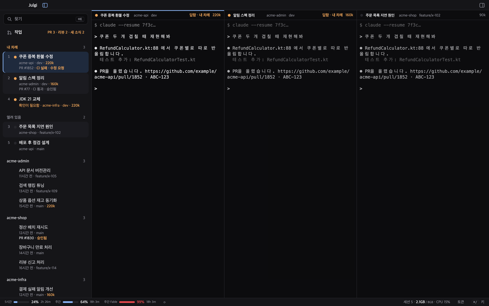
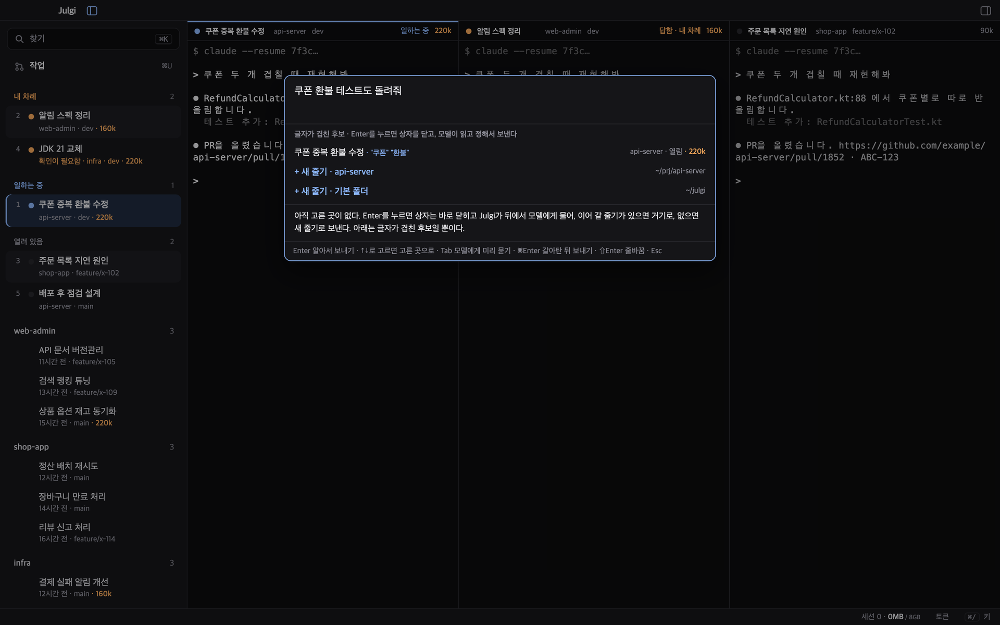
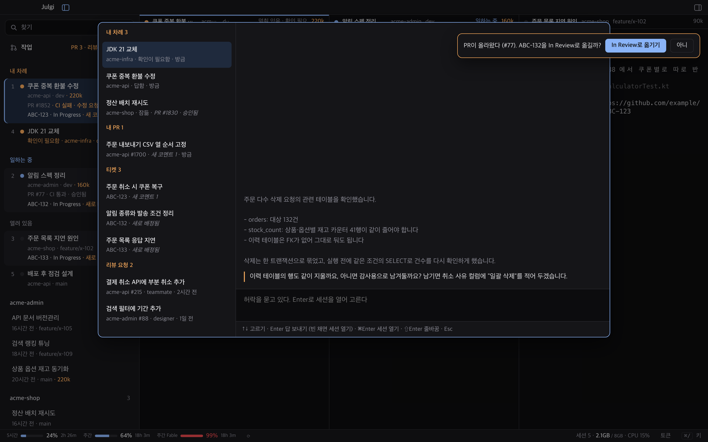
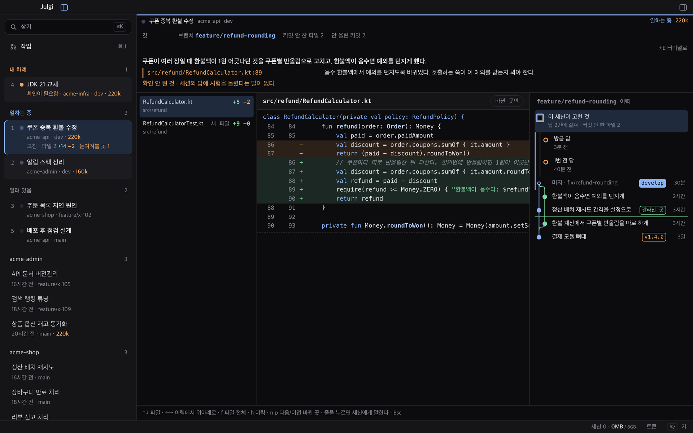
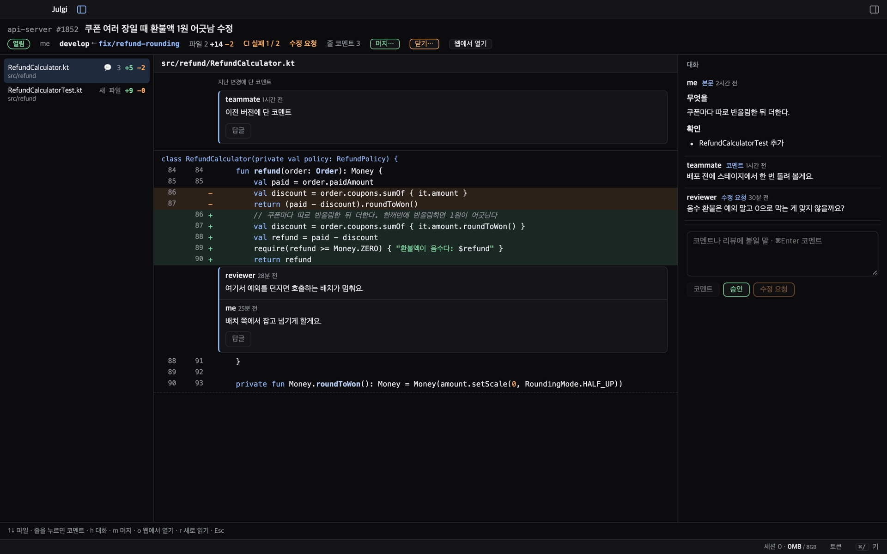
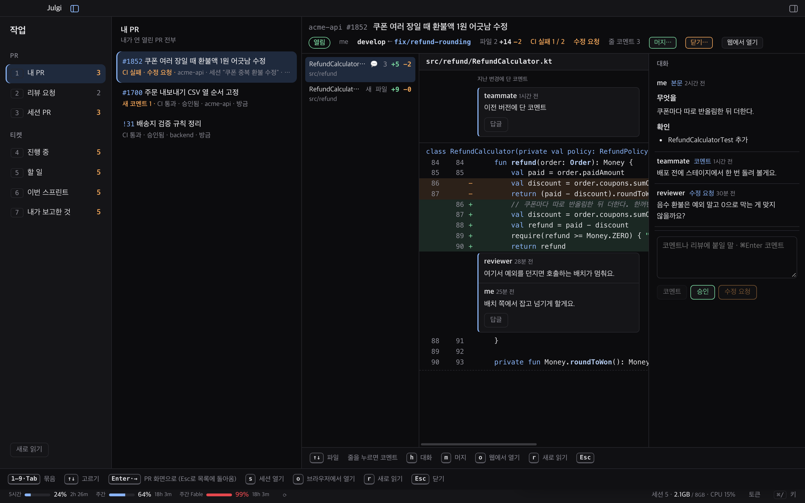
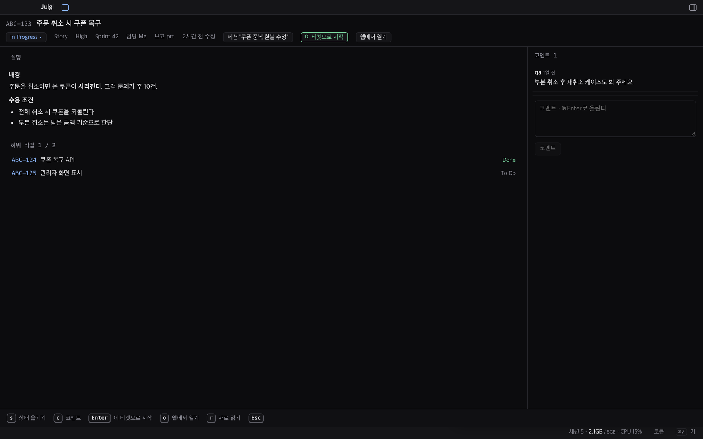
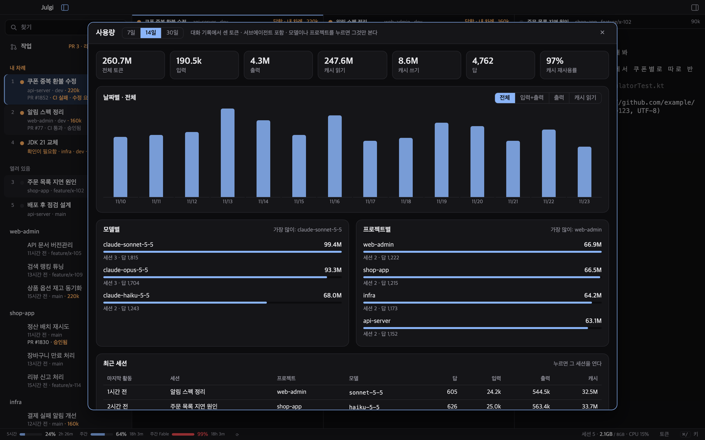

<h1 align="center"><br />Julgi</h1>

<p align="center"><b>只管说要做什么，会话交给 Julgi 照看。</b></p>

<p align="center">
  
  
  
  
</p>

<p align="center"><sub><a href="../../README.md">English</a> · <a href="README.ko.md">한국어</a> · <a href="README.ja.md">日本語</a> · 简体中文</sub></p>

<p align="center">
  一款 macOS 应用：把多个 <a href="https://claude.com/claude-code">Claude Code</a> 会话并排放在一个窗口里，<br />
  替你决定消息该发给哪个会话，以及现在该看哪一个。
</p>

<p align="center"></p>

*Julgi*（줄기，读作“jool-gi”）在韩语里是植物的茎。在这个应用里，**茎（stem）** 指一件工作，以及接力完成它的一串会话。

> [!NOTE]
> 界面有英语和韩语（跟随系统语言，可在 `⌘,` 里更改）。只在 macOS 上用过。没有签名的安装包，需要自己构建（一个脚本即可）。

## 为什么做它

用代理同时推进几个项目，很快就会变成：好几个仓库，每个仓库好几个标签页，每个标签页好几个会话。于是你得自己记着：哪个会话在做什么，哪个在等你，哪个可以先放下。分散注意力的不是工作本身，而是这份记账。

Julgi 接手这份记账。**你只管把工作丢过来，会话交给 Julgi 照看。** 它挑出消息该去的会话，只把需要你的提到前面，让空闲的会话休眠，把做同一件事的会话并在一起，并把跨仓库的工作拆给多个会话再汇总结果。

## 功能

<table>
<tr>
<td width="42%">

### 只管说 — `⌘L`

输入想做的事，按 Enter。Julgi 读懂内容后，选出原本就在做这件事的会话，或者在合适的仓库里新开一个。会话太大时，会先写一份交接说明，换到新会话再发送。

</td>
<td></td>
</tr>
<tr>
<td>

### 轮到我 — `⌘J`

所有在等你的会话，按等待时间从长到短排列，并附上它最后问的问题。不用打开会话，直接在这里回答。需要你处理的 PR 和工单也排在同一个队列里。

</td>
<td></td>
</tr>
<tr>
<td>

### 代码评审 — `⌘E`

查看会话改了什么：全部、按每次回复，或在提交图上逐个提交查看。Julgi 会概述改了什么、为什么改，再用更大的模型复读一遍。点击某一行，就可以针对这一行对会话说话。

</td>
<td></td>
</tr>
<tr>
<td>

### 不用浏览器处理 PR

GitHub PR 和 GitLab MR 都在 Julgi 里打开：diff、行内评论与回复、CI、评审。可以评论、批准、请求修改、合并、关闭。Julgi 会盯着你的 PR，CI 失败、有人评论或评审到达时通知你。

</td>
<td></td>
</tr>
<tr>
<td>

### 工作页 — `⌘U`

在一个地方看全所有东西：我的 PR、评审请求、会话提交的 PR，以及按分组的 Jira 工单。选中后，右侧打开对应的 PR 或工单。

Bug 与其他工单分开显示，一个按钮就能把它们全部交给会话。会话只做诊断然后停下，“修复”还是“搁置”在 `⌘J` 里选择。

每个工单都会显示现在轮到谁做什么，依据是 Julgi 所知道的该工单的会话和 PR：会话在等你、CI 失败、已批准可以合并、已合并该移动工单、尚未开始。需要你处理的排在最前。

</td>
<td></td>
</tr>
<tr>
<td>

### 从工单开始

在 Julgi 里打开 Jira 工单，点“用这个工单开始”：新建工作树和分支，启动一个已读过工单内容的会话，并把工单移到 In Progress。PR 提交或合并后，Julgi 会询问是否把工单移到下一个状态。

</td>
<td></td>
</tr>
<tr>
<td>

### Token 去哪了 — `⌘⇧U`

按日期、模型、项目、会话统计 token，数据来自 Claude Code 自己的对话记录。点击某个模型或项目，只看它。

</td>
<td></td>
</tr>
</table>

### 还有这些

- **不用浏览器看 CI** — 你触发的运行（包括合并后的部署）都列在 `⌘U` 里，每个 job 的状态和耗时一目了然。失败的 job 会显示日志末尾，一个按钮就能交给会话去修。
- **只在需要时叫你** — 会话回复结束后，小模型会读这条回复。有提问或需要你决定时才提到“轮到我”；只是汇报完成的会安静放着，在简报里汇总。做到一半停住的会话，或一个请求跑得太久的会话，会单独提醒。
- **简报** — 离开一段时间后回来，一屏显示：谁在等你、PR 和工单的新动态、各项工作进行到哪、这期间 Julgi 做了什么（`⌘⇧B`）。
- **每根茎的进度** — 每项工作的目标、已完成、剩余、卡住的地方，随会话回复持续更新。
- **少问权限** — 可选：只读命令，或连同测试和构建，都不再询问直接放行。
- **茎** — 做同一件事的会话会被并成一根茎，做完的工作从列表里撤下。
- **大脑** — 工作结束后仍值得保留的决定、坑和事实会被存下来，并附到需要它们的新工作上。
- **偏好** — 你纠正会话做法的话（“以后……”“不要……”）会变成之后每个会话都遵守的规则。
- **仓库地图** — Julgi 绘制你的仓库地图，让会话能找到并进入其他仓库。
- **协调者** — 跨多个仓库的工作由一个主会话拆成任务，每个任务在自己的工作树里进行。
- **会成长的技能** — 重复做的事会变成技能，用过的技能会根据使用记录打磨。
- **打理** — 长时间空闲的会话会被休眠，在你选中它或它的 PR 有动态时唤醒。
- **主题** — 共十一种，包括 Tokyo Night、Catppuccin Mocha、Dracula 和 Nord，终端配色也随之切换。
- **用手机** — 一个只在你的 Tailscale 网络内可访问的小网页，用来回复和派发新工作。

需要判断的地方（发给谁、是不是同一件事、留下什么），由读过内容的模型决定，而不是字符串匹配。Julgi 自动做过的事都记录在 `⌘Y`，会话不会被删除，每项自动行为都可以在 `⌘,` 里关闭。

## 安装

需要 macOS、Node 20+、Rust（stable）、`git`，以及已登录并在 PATH 中的 `claude` 命令。

<details>
<summary>缺少其中某些？</summary>

```sh
xcode-select --install                                            # 编译器和 git
brew install node                                                 # 或 https://nodejs.org
curl --proto '=https' --tlsv1.2 -sSf https://sh.rustup.rs | sh    # Rust, https://rustup.rs
npm install -g @anthropic-ai/claude-code && claude                # Claude Code，然后登录
```

`scripts/install.sh --check` 会告诉你还缺什么。

</details>

```sh
git clone https://github.com/mangchhe/julgi.git && cd julgi
scripts/install.sh --open    # 检查工具 → 构建 → /Applications/Julgi.app → 启动
```

更新时运行同一条命令。`scripts/install.sh --check` 只检查工具。想改代码：`npm install && npm run tauri dev`。

macOS 在应用读取“文稿”“桌面”“下载”等文件夹前会询问。会话运行在 Julgi 里，所以询问针对的是 Julgi。想一次授权而不是逐个文件夹确认，请在 系统设置 → 隐私与安全性 → 完全磁盘访问权限 中加入 Julgi。钥匙串里有代码签名证书时，安装脚本会为应用签名，你的授权在更新后仍然保留；没有的话，每次更新 macOS 都会忘记。

集成需要额外的东西：GitHub 用 [`gh`](https://cli.github.com)，GitLab 用 [`glab`](https://gitlab.com/gitlab-org/cli)，Jira 需要一个 API token。在 `⌘,` → Connections 里接入。

## 快速上手

1. 打开 Julgi，按 `⌘,` → Map，指定存放仓库的文件夹。
2. 按 `⌘L`，输入想做的事，按 Enter。
3. 会话需要你时会移到“轮到我”。按 `⌘J` 回答。

## 值得记住的按键

| 按键 | 作用 |
|---|---|
| `⌘L` | 说出要做的事，发给谁由 Julgi 决定 |
| `⌘J` | 轮到我：等待中的会话、PR、工单、评审请求 |
| `⌘K` | 查找会话；输入 `pr` 或 `jira` 可挑选 PR 或工单 |
| `⌘E` | 当前会话的代码评审 |
| `⌘U` / `⌘⇧U` | 工作页 / token 用量 |
| `⌘G` | 茎、大脑、技能、统计、地图、git |
| `⌘Y` | Julgi 自动做过的事 |
| `⌘⇧B` | 简报：谁在等你、新动态、工作进展 |
| `⌘T` / `⌘D` / `⌘W` | 在新窗格开 shell / 增加窗格 / 关闭 |

其余按键见应用内的 `⌘/`。

## 工作原理

1. **会话就是终端里普通的 `claude` 进程。** Julgi 启动时附带几个钩子，把会话状态（工作中、等待、提问）写入文件，再读取这些文件。
2. **没有服务器，也没有数据库。** Julgi 知道的一切都是 `~/.julgi/` 下的文本文件。对话仍留在 Claude Code 存放的位置。
3. **判断通过 `claude -p` 完成。** 路由、摘要、概述和打理，都是用你自己的 Claude 登录发出的简短纯文本调用。

GitHub 走 `gh`，GitLab 走 `glab`，Jira 走 REST API，Jira token 保存在 macOS 钥匙串里。Julgi 没有可以接收 webhook 的服务器，所以采用定时轮询。

## 为什么只支持 Claude Code

Julgi 不运行 Codex CLI、Gemini CLI 等其他代理。它替你做的事（判断轮到谁、摘要、交接、把记忆带进会话）依赖 Claude Code 的钩子、对话记录和启动选项。其他 CLI 目前只覆盖其中一部分。只被照看一半的会话会把记账重新推回给你，所以没有加入。等它们跟上后会再评估。

## 参考文档

Julgi 授予会话的权限、扩展点、全部设置、写入的文件和已知不足，见 [docs/reference.md](../reference.md)（英文）。使用前请先读权限一节。

## 参与贡献

提交规范以及如何用模拟数据打开界面，见 [CONTRIBUTING.md](../../CONTRIBUTING.md)（英文）。

## 许可证

MIT
